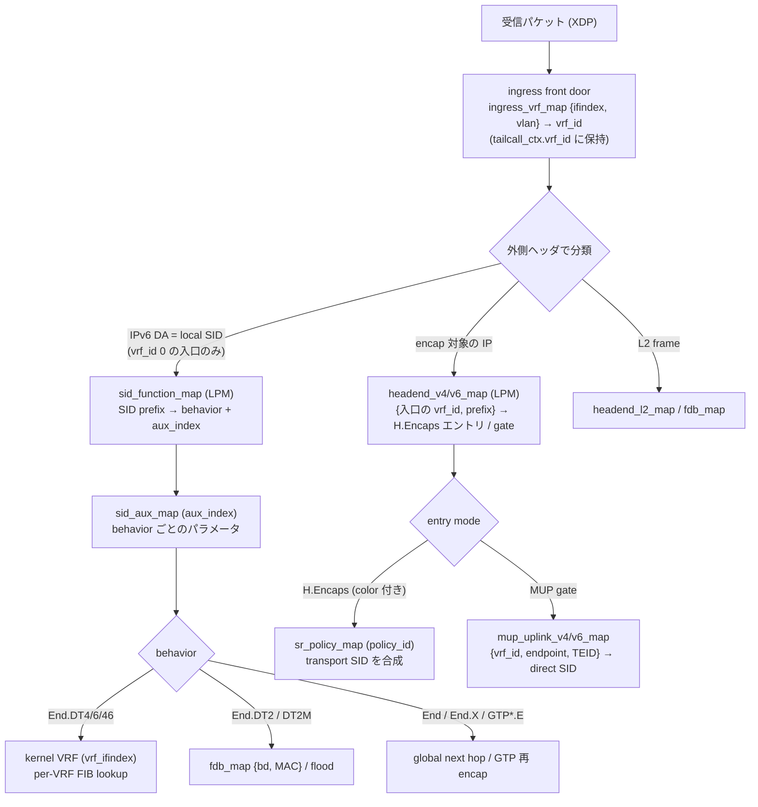

# 転送テーブルのメンタルモデル

## 概要

このドキュメントは、Vinbero がパケットを転送するときにどのテーブルをどの順で引き、それぞれのテーブルが何で分かれているか、というメンタルモデルを整理します。個々のマップの実装詳細ではなく、テーブル同士の関係とスコープに焦点を当てます。SRv6 サービスを BGP でどう運ぶかは [srv6_bgp.md](./srv6_bgp.md)、L2VPN/L3VPN のデータプレーンは [fdb_vrf.md](./fdb_vrf.md)、headend の複数 path 分散は [ecmp.md](./ecmp.md) を参照してください。

まず押さえたいことが 2 つあります。テーブルは control plane と data plane の 2 層に分かれること、そして転送テーブルの持ち主が kernel と eBPF の 2 つに分かれることです。

control plane (Go、in-memory) は何を install するかを決め、data plane (eBPF マップと kernel FIB) がそれを高速に実行します。control plane のテーブルは BGP 経路や RPC を受けて方針を保持し、その結果を data plane のテーブルへ書き込みます。

転送テーブルの持ち主は 2 つです。kernel が L3 の per-VRF FIB を持ち、eBPF が SRv6 service テーブル (local SID、headend、F-TEID) と L2 テーブル (FDB、bridge domain) を持ちます。eBPF 側の VRF ごとの表は、どの SID へ encap するかを決める headend と F-TEID の表です。VRF の中の宛先へ届ける L3 lookup (End.DT4/DT6/DT46 で kernel VRF へ渡したあとと、headend に一致しなかったパケット) は kernel に任せます。BGP で学んだ IPv6 unicast 経路も kernel FIB へ注入します (`pkg/fib`)。

## 転送の lookup chain

受信パケットは XDP で外側ヘッダにより分類され、テーブルを順に辿って転送先が決まります。

パケットはまず ingress front door を通ります。`ingress_vrf_map` を {ifindex, vlan} で引いて vrf_id を決め、`tailcall_ctx.vrf_id` に載せて以降のハンドラへ運びます。front door が無効なら全パケットが global VRF (vrf_id 0、underlay) になります。default-deny を有効にすると、どの VRF にも分類されない access circuit を drop できます。

`sid_function_map` を引くのは vrf_id 0 のパケットだけです。tenant VRF の access circuit から来た IPv6 パケットは、宛先がこのノードの local SID でも SID の表を引かずに headend の lookup へ進みます。このゲートが守る範囲と、kernel の VRF table が受け持つ残りは [vrf.md](vrf.md) の「local SID と AC」にあります。local SID 宛のパケットは `sid_function_map` で behavior を引き、`sid_aux_map` に置いた behavior ごとのパラメータで配送先が決まります。decap 系 (End.DT4/DT6/DT46) は aux の vrf_ifindex が指す kernel VRF へ渡し、そこからは kernel の per-VRF FIB が転送します。End.DT2/DT2M は bridge domain へ、End や End.X や GTP behavior は global の next hop へ向かいます。uSID の uN と uA も同じ `sid_function_map` に載りますが、これらは /128 でなく locator prefix (/48 と /64) のエントリで、DA を書き換えながら転送します。詳細は [usid.md](usid.md) を参照してください。

encap 対象のパケットは `headend_v4/v6_map` を {vrf_id, prefix} で引きます。vrf_id は front door が決めた入口の VRF です。tenant VRF のパケットはその VRF の entry だけに一致し、一致しなくても global VRF の entry を引き直しません。AC の無い入口のパケットは global VRF (vrf_id 0) の entry を引きます。BGP の applier は受信した VPN 経路を import する各 VRF に書き、RPC と plugin は指定した VRF (省略時は global VRF) に書きます ([vrf.md](vrf.md#headend-entry-の-vrf))。そのため同じ prefix でも VRF ごとに別の転送先を持てます。エントリが H.Encaps なら service SID へ encap し、color が付いていれば `sr_policy_map` を policy_id で引いて transport SID を前置します。エントリが MUP の gate なら、front door で決めた vrf_id を使って `mup_uplink_v4/v6_map` を {vrf_id, endpoint, TEID} で引いて direct SID を得ます。同じ N3 endpoint と TEID 空間を複数の VRF が共有しても、vrf_id がキーに入るので衝突しません。encap した外側の IPv6 ヘッダの next hop は main table で引きます。vrf_id 0 のパケットは入口の interface で (ip rule を通して)、tenant VRF のパケットは ip rule を通さずに main table を直接引きます (`BPF_FIB_LOOKUP_TBID` を受け付ける kernel の場合。受け付けない kernel ではすべて入口で引き、VRF の table は閉じません)。next hop の neighbour は vinberod が managed の entry にして解決したまま保ちます。link の flap で kernel が neighbour を消しても作り直し、carrier が戻るとすぐに解決し直します。詳細は [vrf.md](vrf.md) の「encap の外側の経路」と「encap の next hop の neighbour」にあります。ip rule の履歴が FIB lookup のコストに効くことは「ip rule と FIB lookup のコスト」にあります。headend に一致しなかったパケットは kernel へ渡し (XDP_PASS)、入口が VRF device に enslave されていれば kernel の VRF table が引きます。Vinbero が管理する VRF の table は unreachable default で終わるので、table に無い宛先は main table へは進みません。

## スコープ軸

転送テーブルは次の軸で分かれます。どの軸に属するかで、テーブルのキーに何が入るかと、誰が tenant を分けるかが決まります。

- global: ノード全体で 1 つ。tenant の次元を持ちません。`sid_function_map`、`sr_policy_map` がこれです。local SID 空間はノード共通です。local SID は vrf_id 0 の入口から来たパケットだけが使えます。
- VRF (vrf_id): routing/forwarding instance の identity です。control plane では `pkg/vrf` の一級オブジェクトが name と数値 vrf_id (0 = global/underlay) と ingress membership ({interface, VLAN}) を持ちます。data plane では front door が ingress access circuit を vrf_id に分類し、headend の lookup (`headend_v4/v6_map`) と MUP F-TEID lookup (`mup_uplink_v4/v6_map`) がその vrf_id をキーに含めるので、同じ宛先 prefix や同じ N3 endpoint と TEID 空間を複数の VRF が使っても衝突しません。BGP の RT policy (`vrfbgp`)、MUP、EVPN は name で VRF に紐付く facet です。オブジェクト全体の設計は [vrf.md](vrf.md) を参照してください。
- kernel VRF: VRF の L3 facet です。End.DT4/DT6/DT46 が aux の vrf_ifindex で kernel VRF へ渡し、per-VRF の L3 FIB は kernel が持ちます。eBPF 側はどの VRF へ渡すかだけを決めます。この kernel device は VRF object の facet として `vrf.Manager` が lifecycle を持ち、1 つの VRF が vrf_id と table_id と ifindex を併せ持ちます。作成と削除は `vbctl vrf create` / `vbctl vrf delete` または config の `vrfs.entries[].table_id` で、netlink 操作と JSON state への永続化は `pkg/netresource` が機構レイヤとして担います。削除は ingress AC、vrf-bgp binding、bridge facet、その vrf_id の headend entry、SID 参照のいずれかが残っている間は拒否します ([vrf.md](vrf.md#削除))。config から entry を消しても device は消えません (config は加算的で、削除は明示的な `vbctl vrf delete` です)。data plane の lookup キーは ifindex です (kernel の要求)。Vinbero が作るか adopt した device の table には unreachable default を足すので、per-VRF の lookup は table に無い宛先で main table へ進みません。End.DT4/DT6/DT46 が decap したパケットも、VRF table に無い宛先なら drop します。
- bridge domain (bd): L2 の tenant です。`fdb_map` を {bd, MAC} で引き、BUM は bd 単位で flood します。

## default と explicit という共通パターン

どのスコープ軸にも、設定不要の default fallback と、明示的に tenant を切る explicit 形があります。default は設定が無いときの挙動で、instance 化や VRF 化をする前と同じ動きになります。

- kernel routing: main table が default、named VRF が explicit です。
- VRF 分類: global VRF (vrf_id 0) が default、`vbctl vrf ac-add` で access circuit を宣言した named VRF が explicit です。どの VRF にも分類されない access circuit は vrf_id 0 に落ち、default-deny を有効にすると drop します。default-deny 下で underlay や control 用の interface を通したいときは、予約名 `global` の VRF に AC を足して明示的に vrf_id 0 へ分類します。`global` は予約名で、tenant VRF には使えず id も常に 0 です。
- SR Policy steering: color 0 が default で service SID へ直行し、color が付くと SR Policy へ steering します。
- RT import: binding が無い family は default の挙動 (L3VPN と MUP は default-allow、EVPN は bd が要るので drop)、binding を宣言すると explicit に import を絞ります。L3VPN と MUP では binding の変更で import が変わると受信済みの経路を評価し直すので、default-allow で global VRF に入った経路も最初の binding で import する VRF へ移ります。

このパターンを意識すると、新しいサービスを足すときに default をどう定義するか、explicit な tenant を何で分類するかの 2 点を決めればよい、と見通せます。

## テーブル早見表

転送先を決める主なテーブルです。owner は kernel か eBPF か、writer は control plane の誰がそれを書くかを表します。

| テーブル | キー | 値 | スコープ | owner | writer |
|------|------|------|------|------|------|
| sid_function_map | IPv6 SID prefix (LPM) | behavior + aux_index | global | eBPF | SidFunctionService |
| sid_aux_map | aux_index | behavior パラメータ (vrf_ifindex / bd / GTP args ほか) | global | eBPF | SidFunctionService |
| headend_v4/v6_map | {vrf_id, IP prefix} (LPM、vrf_id は完全一致) | H.Encaps エントリ / gate / policy_id / group_id | VRF | eBPF | Headend*Service / BGP applier / plugin |
| ecmp_group_map / ecmp_path_map | group_id / {group_id, path_index} | weight 付き path 集合 (headend_entry) | global | eBPF | control plane (ECMP group) |
| ecmp_live_map | group_id | liveness bitmap | global | eBPF | prober |
| sr_policy_map | policy_id | transport SID list | global | eBPF | SrPolicyService / BGP applier |
| ingress_vrf_map | {ifindex, vlan} | vrf_id | VRF (vrf_id) | eBPF | VrfService / config (`vrf.Manager`) |
| mup_uplink_v4/v6_map | {vrf_id, endpoint, TEID prefix} (LPM) | direct SID | VRF (vrf_id) | eBPF | BGP applier (MUP T2ST) |
| headend_l2_map | {ifindex, vlan} | H.Encaps.L2 エントリ (bd、direct encap の segment) | port | eBPF | HeadendL2Service (state ファイルに保存し、再起動時に戻す) |
| fdb_map | {bd, MAC} | bd_peer | bridge domain | eBPF | FdbService / BGP applier (EVPN RT2) |
| bd_peer_map ほか | bd / peer | End.DT2U/DT2M peer、flood、DF | bridge domain | eBPF | BdPeerService / BGP applier (EVPN) |
| kernel VRF FIB | inner dst | next hop | kernel VRF | kernel | kernel (decap 後) + `pkg/fib` (BGP IPv6 unicast) |

control plane 側の in-memory テーブルが上の data plane を populate します。VRF の identity (name、vrf_id、ingress membership、global default-deny policy) は `vrf.Manager` が持ち、`ingress_vrf_map` の唯一の writer です。VRF↔RT の binding は `vrfbgp.Manager` (family ごとの RT policy と RD、MUP の source prefix を保持し、VRF object を Ensure する facet。EVPN の bridge domain は VRF の bridge facet から導出)、SR Policy は {color, endpoint} を鍵にした table、locator プールは `locator.Manager`、MUP の segment discovery とセッションは applier 内のテーブルが持ちます。

## 転送決定ではない補助テーブル

次のマップは転送先を決めません。混同しないよう分けて書きます。owner_map 系 (`sid_function_owner_map`、`headend_v4/v6_owner_map`、`aux_owner_map` ほか) はエントリの所有者を記録し、同じ owner の経路だけを正確に withdraw するために使います。`*_progs` (PROG_ARRAY) は tail call の dispatch、`scratch_map` と `tailcall_ctx_map` は per-CPU の作業領域と tail call 間の受け渡し、`stats_map` と `slot_stats_*` はカウンタです。
