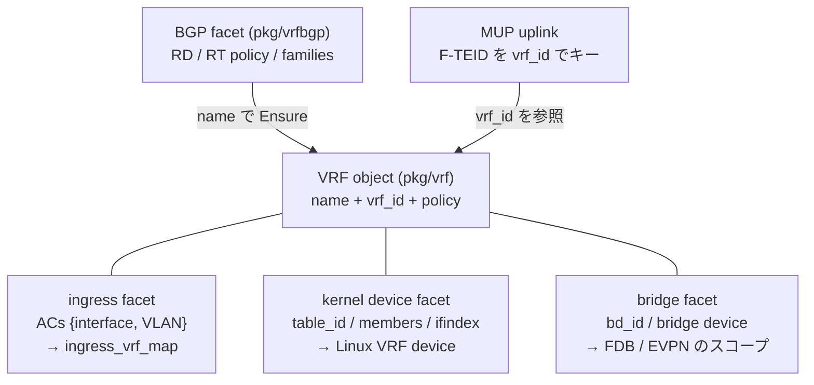

# VRF オブジェクト設計

## 概要

Vinbero の VRF は 1 つの一級オブジェクトです。`pkg/vrf` の Manager が identity を持ち、ingress 分類、kernel device、BGP policy、MUP uplink はすべてこのオブジェクトに付く facet として表現します。「IngressVRF」や「uplink instance」のような別概念は存在せず、VRF は VRF です。

1 つの VRF は次を持ちます。

- name。全 facet を結ぶ唯一の join key です。
- vrf_id。data plane の数値 id です。0 は global/default VRF (underlay) に予約され、tenant VRF には 1 以上が割り当てられます。
- ingress access circuit (AC)。この VRF に属する {interface, VLAN} の集合です。
- kernel device facet (任意)。End.DT4/DT6/DT46 が decap 後の FIB lookup に使う Linux VRF device です。持たない VRF (deviceless) も正当で、MUP gateway のように ingress 分類だけを使う構成がこれにあたります。
- bridge facet (任意)。End.DT2/DT2M が decap したフレームを配送する Linux bridge と、FDB / EVPN 広告をスコープする bd_id です。L2 だけの EVI (kernel device なし) も正当です。



## identity と vrf_id

vrf_id は `vrf.Manager` が割り当てます。最初に参照された時点で遅延作成され (`Ensure`)、次のどの経路でも同じ VRF になります。

- `vbctl vrf ac-add` で AC を足す
- `vbctl vrf create` で kernel device を作る
- `vbctl vrf bridge-attach` で bridge を attach する
- `vbctl vrf-bgp bind` で BGP binding を張る (binding の公開前に Ensure が走るので、並行する route apply が vrf_id 未割当ての binding を見ることはありません)
- config の `vrfs.entries[]`

vrf_id は単調増加で、削除された VRF の id も別の VRF には使いません。割り当てる id は 1 から 4294967293 までです。使い切ると、新しい VRF を作る操作 (`vbctl vrf ac-add` 等) は失敗します。id 0 に戻ることはありません。vrf_id を key にした状態が VRF より長く残っても、別の tenant を指さないためです。割り当ては `state.json` に保存し、同じ VRF は再起動後も同じ id を持ちます。予約名 `global` は常に id 0 で、tenant には使えません。`global` に AC を足すと {ifindex, vlan} → 0 の明示エントリになり、default-deny 下でも underlay/control interface を通せます。`global` は kernel device も bridge も持てません (global VRF は underlay そのものを指すためです)。

## ingress facet

data plane は XDP 入口で ingress front door を 1 回だけ通します。`ingress_vrf_map` ({ifindex, vlan} → vrf_id) を引き、結果を `tailcall_ctx.vrf_id` に載せて下流のハンドラへ運びます。front door は AC が 1 つでも存在するか default-deny が有効なときだけ enable され、無効なら全パケットが vrf 0 になります (後方互換)。

- `VrfAcAdd` で足した AC の interface が後から消えた場合、reconcile はその AC を飛ばします (pod の veth が AC の削除より先に消えても、他の AC の操作を止めないためです)。warning は消えた AC ごとに 1 度だけ出します。AC は `VrfAcRemove` (`vbctl vrf ac-remove`) まで残り、同じ名前の interface が戻れば再び効きます。記録を自動では消さないのは、消すとその interface 名が vrf 0 に分類されるようになるためです。config の `vrfs.entries[].acs` の AC は、interface が解決できなければ reconcile を失敗させます。
- `VrfAcAdd` で足した AC は `state.json` に記録し、再起動後に元の VRF へ戻します。interface が消えていれば上と同じく warning を出して飛ばし、記録は残します。不要になった記録は `vbctl vrf ac-remove --vrf <name> --interface <ifname>` で消します。config が同じ AC を宣言すると config の AC として扱い、別の VRF に宣言されていれば config の VRF に移します。
- AC はちょうど 1 つの VRF に属します。別 VRF が持つ AC の追加は拒否されます (map の衝突キーを作らせない)。
- default-deny を有効にすると、どの VRF にも分類されない AC のパケットを drop (または pass) します。underlay/control interface を通すには `global` VRF に AC を足します。
- front door は {ifindex, vlan} を完全一致で引きます。AC の無い {ifindex, vlan} は、default-deny が有効なら `deny_action` に従います。以下は default-deny が無効な場合です。
  - tag 付きのフレームの {ifindex, vlan} に AC が無く、同じ port の untagged 側 ({ifindex, 0}) が tenant VRF の AC なら、そのフレームは vrf 0 になりません。operator がその {ifindex, vlan} に設定した service proxy の戻り (IFACE-IN) か L2 headend の circuit だけが受け取れ、どちらも無ければ L3 や SID の処理の前に drop します。tenant が未使用の VLAN tag を付けて vrf 0 に入るのを防ぐためです
  - untagged 側が underlay (AC が無いか `global` の AC) の trunk では、AC の無い tag は vrf 0 になります
  - VLAN の AC しか持たない port に届いた untagged のフレームも vrf 0 になります。その port で同じ保証が要るときは default-deny を有効にします
- `ingress_vrf_map` の writer は `vrf.Manager.Reconcile` だけです。

詳細は [forwarding_model.md](forwarding_model.md) の VRF axis を参照してください。

### local SID と AC

local SID の表 (`sid_function_map`) を引くのは、vrf_id 0 に分類された入口から来たパケットだけです。tenant VRF の AC から来た IPv6 パケットは、宛先がこのノードの local SID でも SID の behavior を通りません。宛先が SID でないパケットと同じく headend の lookup へ進み、一致しなければ kernel へ渡します (XDP_PASS)。tenant のアドレス空間では、provider の SID と同じ値の宛先もただの tenant のアドレスなので、drop はしません。

SID ごとの例外は無く、AC に分類した interface では SID は一切使えません。たとえば N3 の interface を VRF の AC にすると、その interface に届く IPv6 の GTP-U に End.M.GTP6.D は働かず、パケットは kernel へ渡ります。SRv6 を受ける interface は、AC を持たないままにするか `global` VRF の AC にします。

このゲートが守るのは、このノードの XDP が処理する local SID だけです。XDP が kernel へ渡したパケットは、kernel の VRF table が受け持ちます。Vinbero が作るか adopt した VRF の table は unreachable default で終わるので ([kernel device facet](#kernel-device-facet))、table に無い宛先は main table へ進まずにそこで止まります。別の PE の SID 宛のパケットも、table に locator の範囲への経路が無ければここで止まります。次の場合は守りません。

- VRF table に locator の範囲 (または default) への経路を置いた場合。パケットはその経路で underlay へ出て、別の PE の SID に underlay 側から届きます
- VRF を `no_unreachable_default` で作った場合と、Vinbero が管理していない VRF device の場合。table に一致する経路が無いと、kernel は main table へ進んで探します
- AC にした interface が VRF device に enslave されていない場合。kernel はそのパケットを main table で引きます。このような AC も使えますが、miss は global の table に届きます
- 同じ SID の kernel の seg6local route がある場合。XDP が渡したパケットを kernel が処理します

tenant の interface は VRF device に enslave し、同じ VRF の AC にしてください。AC にしないと、その interface から来たパケットの encap が VRF table で止まります ([encap の外側の経路](#encap-の外側の経路))。

### encap の外側の経路

headend が encap したパケットの外側の IPv6 ヘッダは underlay のパケットなので、`bpf_fib_lookup` は main table で引きます。引き方は入口の vrf_id で決まります。

- vrf_id 0 のパケットは、入口の interface で引きます。ip rule を通るので、underlay の policy routing も効きます
- tenant VRF の AC から来たパケットは、入口の interface を使わず main table を直接引きます (`BPF_FIB_LOOKUP_DIRECT | BPF_FIB_LOOKUP_TBID`、table 254)。入口が VRF device に enslave されていると、入口で引いた lookup は l3mdev rule で VRF table へ進み、unreachable default で止まるか、SID を覆う tenant の経路に従ってしまうためです。ip rule は通りません。`BPF_FIB_LOOKUP_TBID` の無い kernel (6.5 より前) では helper が flag を拒否するので、VRF に enslave できない loopback device で `BPF_FIB_LOOKUP_DIRECT` の lookup をやり直します。こちらも main table を引きます

対象は H.Encaps と H.Encaps.Red (IPv4 / IPv6)、H.Insert と H.Insert.Red、H.Encaps.L2 系、MUP の H.M.GTP4.D と GTP6 の headend、service proxy の戻り (End.AS / End.AD / End.AM) です。BUM の複製は送信元の bridge port で引きます (bridge port は VRF device に enslave できません)。

VRF device に enslave したまま AC にしていない interface は vrf_id 0 なので、encap の外側も入口で引き、VRF table の unreachable default で drop になります。

外側の next hop の neighbour が未解決 (NO_NEIGH) のとき、encap したパケットは kernel へ渡して解決させます。enslave した入口から渡したパケットは kernel が VRF table で引くので、unreachable default で止まり、解決のきっかけになりません。next hop の neighbour は BGP など別の通信で解決されている必要があります。

## kernel device facet

End.DT4/DT6/DT46 は decap 後に `bpf_fib_lookup(ifindex=VRF device)` で per-VRF FIB を引くため、Linux VRF device が必要です。この device の lifecycle を VRF オブジェクトが持ちます。

- 作成は `VrfService/VrfCreate` (CLI は `vbctl vrf create --name X --table-id N [--members ...] [--enable-l3mdev-rule] [--no-unreachable-default]`)。netlink 操作と JSON state への永続化は `pkg/netresource` が機構レイヤとして担い、`vrf.Manager` は `DeviceOps` interface 経由で駆動します (ingress facet に対する `Programmer`/`bpf.MapOperations` と同じ分離)。
- 同名 device が既に居る場合は adopt します。ただし link が本当に VRF device で table が一致するときだけです (名前一致だけで NIC を取り込まない)。adopt は device を up にし、不足 member を enslave し、l3mdev rule を要求どおり足します。
- 作成と adopt では、table に IPv4 と IPv6 の `unreachable default` (metric 4278198272、protocol boot) を足します。Linux の VRF のドキュメントが勧める経路で、metric を大きくしてあるので table の他の経路が常に優先されます。これが無いと、table で一致しなかった lookup は l3mdev rule を抜けて main table へ進みます。member を enslave する前に足すので、member のパケットが main table に届く間はありません。table に operator の default route が既にあれば置き換えず、そちらが使われ続けます。同じ metric の経路が既にあればそれを残します。protocol が boot なので、route watcher (redistribute `static` / `connected`) は広告しません。
- 次の構成では `--no-unreachable-default` (config では `no_unreachable_default: true`) を指定します。kernel の seg6 encap route を VRF table に置き、外側の SID を main table で引かせる構成や、tenant の通信を main table で折り返す構成です。この VRF の table に一致しない lookup は main table へ進みます。
- state への記録はマージです (members は union、l3mdev flag は OR、unreachable default の opt-out は全要求が opt-out のときだけ残る)。runtime は device を上方収束しかしない (enslave/add のみ) ため、未指定フィールドで記録が弱まることはありません。opt-out を後から指定しても、足した経路は消しません。device を縮めたいときは delete して作り直します (table 変更と同じ)。
- l3mdev rule は本物の `from all lookup [l3mdev-table]` rule を prio 1000 に入れます (FRA_L3MDEV を raw rtnetlink で構築)。
- 削除では、device を消したあとで table の unreachable default も消します。device を使わない経路は device と一緒には消えないためです。opt-out した VRF の table と、同じ table を使う別の VRF がまだある table には触れません。

data plane の lookup キーはあくまで ifindex です (kernel FIB の要求)。vrf_id と ifindex の両方を 1 つの VRF が持つことで、operator からは 1 つのオブジェクトに見えます。

## bridge facet

EVPN / L2VPN の bridge domain も VRF オブジェクトの facet です。End.DT2/DT2M が decap したフレームを配送する Linux bridge (FDB miss 時の flood 先) と、`fdb_map` や `bd_peer_map` をスコープする bd_id (1..65535) を 1 つの VRF が持ちます。

- attach は `VrfService/VrfBridgeAttach` (CLI は `vbctl vrf bridge-attach --vrf X --name brN --bd-id N [--members ...]`)。netlink と JSON state への永続化は device facet と同じく `pkg/netresource` が `BridgeOps` interface 経由で担い、state record は owning VRF 名も持ちます。attach は FDBWatcher への登録 (MAC 学習と EVPN RT2 の供給源) も行います。
- 一意性は attach 時に強制されます。1 つの VRF が持てる bridge は 1 つ、1 つの bridge device / 1 つの bd_id が属せる VRF も 1 つです。
- facet が bridge domain の唯一の出所です。BGP binding は bd を持たず、受信した EVPN route (RT2/RT3) は RT が一致した binding の VRF が持つ facet の bd に install されます。facet の無い VRF の binding は EVPN route を import しません (fail-closed)。import 面 (binding + facet) がそろっていない間に届いた route は drop されますが、attach または bind で面が広がった時点で gobgp loc-rib の snapshot を受信経路に再適用して救済します (install は冪等なので重複適用は無害)。bridge-attach を vrf-bgp bind より先に行う順序は引き続き推奨で、replay はその安全網です。
- adopt のセマンティクスは device facet と同じです。link が本当に bridge であること、state 上の bd_id / owner と矛盾しないことを検証し、up + 不足 member の enslave で収束します。
- port の増減は `VrfService/VrfBridgeMemberAdd` / `VrfBridgeMemberRemove` (CLI は `vbctl vrf bridge-member-add|bridge-member-remove --vrf X --interface I`) で 1 つずつ行えます。追加した port は state の `runtime_members` に記録され、再起動時に消えていれば起動を止めずに捨てます。詳細は [device_attach.md](device_attach.md#bridge-member-の実行時追加) を参照してください。
- detach (`vbctl vrf bridge-detach --vrf X`) は End.DT2/DT2M の SID が bridge を参照している間は拒否します (EVPN auto-advertise が自分で入れた lifecycle SID は除外)。device の削除に成功してから FDBWatcher を解除し、EVPN auto-advertise を disable し、最後に facet を消します。削除失敗時は facet も watcher も無傷で retry できます。

EVPN auto-advertise が有効な場合、bridge facet と EVPN export RT 付きの binding が両方そろった時点で RT3 広告と FDB replay (RT2) が走ります。coordinator は binding の VRF 名から facet を引いて bd_id と bridge ifindex を得るので、bd の数値 join はどこにもありません。

## lifecycle

### 作成

facet ごとに入口が違っても、name が同じなら同じ VRF に集まります。順序の制約はありません (ac-add が先でも vrf create が先でも同じ)。

### 削除

`VrfService/VrfDelete` (CLI は `vbctl vrf delete --name X`) は VRF オブジェクト全体を消します。参照が 1 つでも残っている間は拒否します (refuse-to-guess)。

1. ingress AC が残っている → 拒否 (`vrf ac-remove` で先に外す)
2. vrf-bgp binding が存在する → 拒否 (`vrf-bgp unbind` で先に外す。vpnv4 / vpnv6 の RT を持つ最後の binding を外すと、その family は default-allow に戻り、受信済みの経路がすべて入ります。[srv6_bgp.md](srv6_bgp.md#binding-と-locator-の変更による再評価))
3. bridge facet が付いている → 拒否 (`vrf bridge-detach` で先に外す)
4. End.T/DT4/DT6/DT46 の SID が device ifindex を参照している → 拒否 (`sid delete` で先に外す)。参照チェック中に aux が読めない場合も fail-closed で拒否します (読めない aux が参照かもしれないため)
5. すべて clear なら device を teardown し (table の unreachable default も消します)、identity を消して id を回収します。device 削除が失敗した場合は identity に触れず、retry できます

`global` と、Vinbero 管理外の raw な kernel device (先に `vrf create` で adopt すれば管理下に入る) は削除できません。

## 永続化と boot

kernel device facet、vrf_id の割り当て、実行時に足した AC は `settings.state_path` の JSON state に永続化され、restart を跨いで生き残ります。boot 順序は次のとおりです。id は `ingress_vrf_map` に書く前に state に保存し、XDP と TC を attach する前に `ingress_vrf_map` と policy を書き終えます。attach された interface のパケットが未分類で流れる時間はありません。保存に失敗した場合 (state の置き場所が書けない等) は warning を出して起動を続けるので、その id は記録されないまま data plane で使われます。保存が成功するまでは、次の再起動で各 VRF が同じ id を受け取る保証はありません。

1. `netresource.Reconcile` が state の device と bridge を kernel と突き合わせ、消えていれば再作成し、存在するものは Create と同じ検証と収束で adopt します。実体化できない entry があれば fail-closed で起動を拒否します (stale な ifindex を FDB watcher / EVPN / SID 参照ガードに渡さない。エラーに修復手順が出ます)
2. `Manager.Restore` が保存された vrf_id と次に割り当てる id、実行時の AC を戻します。これより前に id を割り当てる処理はありません。同じ id を持つ 2 つの VRF や `next_vrf_id` 以上の id のように矛盾した state は、推測で直さずに起動を拒否します
3. `--bgp-enabled` のとき、config の `bgp.vrf_bindings` の VRF に id を割り当てます
4. `seedVrfDevices` / `seedVrfBridges` が state を VRF オブジェクトに mirror します (restart 後も facet 付きの一級 VRF として見える)。facet 化以前の bridge record は owning VRF を持たないので、bridge 名を仮の VRF 名として seed します (state file の `vrf` フィールドを書いて再起動すれば本来の VRF に移せます。仮の VRF は何も持たなくなるので、次の項目の規則で戻りません)
5. `loadVRFs` が config の `vrfs:` を適用します (device / bridge は adopt 冪等、AC、policy)
6. `Manager.FinishRestore` が、起動時の読み込みで作られた VRF (`config` 付き) のうち、config がもう宣言しておらず、AC も device も bridge も持たないものを外します。その id は再利用しません。API で作った VRF は `vbctl vrf delete` まで残ります
7. state を保存し、`ingress_vrf_map` と policy を書きます
8. `internal.devices` と、state に記録された実行時 attach の device に XDP / TC を attach します
9. FDB watcher を起動し、bridge facet を登録します。VRF オブジェクトの復元前に登録しようとすると起動を失敗させるので、順序を入れ替えても bridge が黙って監視から漏れることはありません

3 から 5 の順は、id を保存していなかった頃の割り当て順と同じです。`vrf_objects` の無い state で初めて起動しても、各 VRF は前回の起動と同じ id を受け取ります。

起動時の VRF の作成が終わった後は、変更のたびに state を書きます。書き込みに失敗した RPC は、変更をメモリと data plane に反映したままエラーを返し、エラーにはそのことが書かれます。`VrfCreate` と `VrfDelete` は、その VRF を `created` / `deleted_names` に入れたうえで `errors` にも入れます。同じ RPC を繰り返すと保存し直し、それ以外の RPC の保存が成功したときも全量が書かれます。削除済みで保存できていない VRF への `VrfDelete` の再実行は、unknown VRF ではなく保存のやり直しになります。binding は保存しないので、`vbctl vrf-bgp bind` は state の書き込みに失敗しても warning に留め、割り当てた id は次に成功した保存で書きます。起動時の保存も warning に留めるので、state の置き場所が書けない環境でも起動できます。

config は加算的です。`vrfs.entries[]` から entry を消しても device は消えません。削除は明示的な `vbctl vrf delete` だけです。device も bridge も AC も持たない VRF は、config から消すと次の起動で戻りません (上の 6)。

## 操作サーフェス

RPC は `VrfService` に集約されています (旧 `NetworkResourceService` は廃止済みです)。

| 操作 | RPC | CLI |
|------|-----|-----|
| kernel device 作成 (adopt 込み) | `VrfCreate` | `vbctl vrf create --name X --table-id N` |
| VRF 全体の削除 | `VrfDelete` | `vbctl vrf delete --name X` |
| bridge attach (adopt 込み) | `VrfBridgeAttach` | `vbctl vrf bridge-attach --vrf X --name brN --bd-id N` |
| bridge detach | `VrfBridgeDetach` | `vbctl vrf bridge-detach --vrf X` |
| bridge member の追加 / 削除 | `VrfBridgeMemberAdd` / `VrfBridgeMemberRemove` | `vbctl vrf bridge-member-add\|bridge-member-remove --vrf X --interface I` |
| AC 追加 (VRF の遅延作成込み) | `VrfAcAdd` | `vbctl vrf ac-add --vrf X --interface I [--vlan V]` |
| AC 削除 | `VrfAcRemove` | `vbctl vrf ac-remove --vrf X --interface I [--vlan V]` |
| default-deny policy | `VrfSetPolicy` | `vbctl vrf policy --default-deny [--deny-action drop\|pass]` |
| 一覧 (全 facet) | `VrfShow` | `vbctl vrf show` |

`vrf show` は 1 つの表で全 facet を出します。持たない facet の列は `-` になります。

```
VRF       VRF_ID  TABLE_ID  IFINDEX  BD_ID  BRIDGE  INTERFACE  VLAN
vrf-cust  1       100       3        -      -       -          -
evi-100   2       -         -        100    br100   -          -
vpn-a     3       -         -        -      -       eth1       0
```

## config

```yaml
vrfs:
  default_deny: false      # 未分類 AC を drop するか (deny_action: drop | pass)
  entries:
    - name: vrf-cust
      table_id: 100        # != 0 で kernel device を作成 (adopt 冪等)
      members: [eth2]      # device に enslave する interface
      enable_l3mdev_rule: true
      # no_unreachable_default: true  # table に unreachable default を足さない
      acs:                 # ingress 分類 (deviceless でも可)
        - interface: eth1
          vlan: 100
    - name: evi-100
      bridge:              # L2 facet (adopt 冪等)
        name: br100
        bd_id: 100
        members: [eth2]
```

`members` / `enable_l3mdev_rule` / `no_unreachable_default` は device の設定なので `table_id` なしでは拒否されます。`bgp.vrf_bindings[]` は bd_id を持ちません (旧 field は tombstone で、非 0 を設定すると Load 時にエラーになります。0 は未設定と同義です)。EVPN の bridge domain はこの `bridge` facet が唯一の出所です。フィールドの一覧は [configuration.md](configuration.md) を参照してください。

## 関連ドキュメント

- [forwarding_model.md](forwarding_model.md) — 転送テーブル全体でのスコープ軸と lookup chain
- [fdb_vrf.md](fdb_vrf.md) — End.DT* の data plane (device / bridge facet の消費者)
- [bridge_domain.md](bridge_domain.md) — bridge domain の概念と MAC 学習
- [srv6_bgp.md](srv6_bgp.md) — BGP facet (vrf-bgp binding) と MUP の per-VRF uplink
- [persistence.md](persistence.md) — state.json の永続化層
