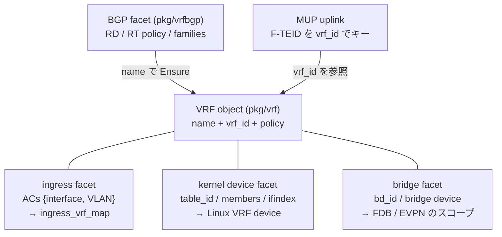

# VRF オブジェクト設計

## 概要

Vinbero の VRF は 1 つの一級オブジェクトです。`pkg/vrf` の Manager が identity を持ち、ingress 分類、kernel device、BGP policy、MUP uplink はすべてこのオブジェクトに付く facet として表現します。「IngressVRF」や「uplink instance」のような別概念は存在せず、VRF は VRF です。

1 つの VRF は次を持ちます。

- name。全 facet を結ぶ唯一の join key です。
- vrf_id。data plane の数値 id です。0 は global/default VRF (underlay) に予約され、tenant VRF には 1 以上が割り当てられます。
- ingress access circuit (AC)。この VRF に属する {interface, VLAN} の集合です。
- kernel device facet (任意)。End.DT4/DT6/DT46 が decap 後の FIB lookup に使う Linux VRF device です。持たない VRF (deviceless) も正当で、MUP gateway のように ingress 分類だけを使う構成がこれにあたります。
- bridge facet (任意)。End.DT2/DT2M が decap したフレームを配送する Linux bridge と、FDB / EVPN 広告をスコープする bd_id です。L2 だけの EVI (kernel device なし) も正当です。



## identity と vrf_id

vrf_id は `vrf.Manager` が割り当てます。最初に参照された時点で遅延作成され (`Ensure`)、次のどの経路でも同じ VRF になります。

- `vbctl vrf ac-add` で AC を足す
- `vbctl vrf create` で kernel device を作る
- `vbctl vrf bridge-attach` で bridge を attach する
- `vbctl vrf-bgp bind` で BGP binding を張る (binding の公開前に Ensure が走るので、並行する route apply が vrf_id 未割当ての binding を見ることはありません)
- config の `vrfs.entries[]`

vrf_id は単調増加で、削除された VRF の id も別の VRF には使いません。割り当てる id は 1 から 4294967293 までです。使い切ると、新しい VRF を作る操作 (`vbctl vrf ac-add` 等) は失敗します。id 0 に戻ることはありません。vrf_id を key にした状態が VRF より長く残っても、別の tenant を指さないためです。割り当ては `state.json` に保存し、同じ VRF は再起動後も同じ id を持ちます。予約名 `global` は常に id 0 で、tenant には使えません。`global` に AC を足すと {ifindex, vlan} → 0 の明示エントリになり、default-deny 下でも underlay/control interface を通せます。`global` は kernel device も bridge も持てません (global VRF は underlay そのものを指すためです)。

## ingress facet

data plane は XDP 入口で ingress front door を 1 回だけ通します。`ingress_vrf_map` ({ifindex, vlan} → vrf_id) を引き、結果を `tailcall_ctx.vrf_id` に載せて下流のハンドラへ運びます。front door は AC が 1 つでも存在するか default-deny が有効なときだけ enable され、無効なら全パケットが vrf 0 になります。VRF を使わない構成は、すべて global VRF の表で転送されます。

- `VrfAcAdd` で足した AC の interface が後から消えた場合、reconcile はその AC を飛ばします (pod の veth が AC の削除より先に消えても、他の AC の操作を止めないためです)。warning は消えた AC ごとに 1 度だけ出します。AC は `VrfAcRemove` (`vbctl vrf ac-remove`) まで残り、同じ名前の interface が戻れば再び効きます。記録を自動では消さないのは、消すとその interface 名が vrf 0 に分類されるようになるためです。config の `vrfs.entries[].acs` の AC は、interface が解決できなければ reconcile を失敗させます。
- `VrfAcAdd` で足した AC は `state.json` に記録し、再起動後に元の VRF へ戻します。interface が消えていれば上と同じく warning を出して飛ばし、記録は残します。不要になった記録は `vbctl vrf ac-remove --vrf <name> --interface <ifname>` で消します。config が同じ AC を宣言すると config の AC として扱い、別の VRF に宣言されていれば config の VRF に移します。
- AC はちょうど 1 つの VRF に属します。別 VRF が持つ AC の追加は拒否されます (map の衝突キーを作らせない)。
- default-deny を有効にすると、どの VRF にも分類されない AC のパケットを drop (または pass) します。underlay/control interface を通すには `global` VRF に AC を足します。
- front door は {ifindex, vlan} を完全一致で引きます。AC の無い {ifindex, vlan} は、default-deny が有効なら `deny_action` に従います。以下は default-deny が無効な場合です。
  - tag 付きのフレームの {ifindex, vlan} に AC が無く、同じ port の untagged 側 ({ifindex, 0}) が tenant VRF の AC なら、そのフレームは vrf 0 になりません。operator がその {ifindex, vlan} に設定した service proxy の戻り (IFACE-IN) か L2 headend の circuit だけが受け取れ、どちらも無ければ L3 や SID の処理の前に drop します。tenant が未使用の VLAN tag を付けて vrf 0 に入るのを防ぐためです
  - untagged 側が underlay (AC が無いか `global` の AC) の trunk では、AC の無い tag は vrf 0 になります
  - VLAN の AC しか持たない port に届いた untagged のフレームも vrf 0 になります。その port で同じ保証が要るときは default-deny を有効にします
- `ingress_vrf_map` の writer は `vrf.Manager.Reconcile` だけです。

詳細は [forwarding_model.md](forwarding_model.md) の VRF axis を参照してください。

### local SID と AC

local SID の表 (`sid_function_map`) を引くのは、vrf_id 0 に分類された入口から来たパケットだけです。tenant VRF の AC から来た IPv6 パケットは、宛先がこのノードの local SID でも SID の behavior を通りません。宛先が SID でないパケットと同じく headend の lookup へ進み、一致しなければ kernel へ渡します (XDP_PASS)。tenant のアドレス空間では、provider の SID と同じ値の宛先もただの tenant のアドレスなので、drop はしません。

SID ごとの例外は無く、AC に分類した interface では SID は一切使えません。たとえば N3 の interface を VRF の AC にすると、その interface に届く IPv6 の GTP-U に End.M.GTP6.D は働かず、パケットは kernel へ渡ります。SRv6 を受ける interface は、AC を持たないままにするか `global` VRF の AC にします。

このゲートが守るのは、このノードの XDP が処理する local SID だけです。XDP が kernel へ渡したパケットは、kernel の VRF table が受け持ちます。Vinbero が作るか adopt した VRF の table は unreachable default で終わるので ([kernel device facet](#kernel-device-facet))、table に無い宛先は main table へ進まずにそこで止まります。別の PE の SID 宛のパケットも、table に locator の範囲への経路が無ければここで止まります。次の場合は守りません。

- VRF table に locator の範囲 (または default) への経路を置いた場合。パケットはその経路で underlay へ出て、別の PE の SID に underlay 側から届きます
- VRF を `no_unreachable_default` で作った場合と、Vinbero が管理していない VRF device の場合。table に一致する経路が無いと、kernel は main table へ進んで探します
- l3mdev rule (prio 1000) より前の ip rule が別の table を選ぶ場合。たとえば prio 100 の `ip rule add ... lookup main` に一致した tenant のパケットは、VRF table を引かずに main table で転送されます。kernel は l3mdev rule より前の rule を許すので、Vinbero はこれを止めません。tenant のパケットに一致しうる rule を l3mdev rule より前に置かないでください
- AC にした interface が VRF device に enslave されていない場合。kernel はそのパケットを main table で引きます。このような AC も使えますが、miss は global の table に届きます
- 同じ SID の kernel の seg6local route がある場合。XDP が渡したパケットを kernel が処理します

tenant の interface は VRF device に enslave し、同じ VRF の AC にしてください。AC にしないと、その interface から来たパケットの encap が VRF table で止まります ([encap の外側の経路](#encap-の外側の経路))。

### encap の外側の経路

headend が encap したパケットの外側の IPv6 ヘッダは underlay のパケットなので、`bpf_fib_lookup` は main table で引きます。引き方は入口の vrf_id で決まります。

- vrf_id 0 のパケットは、入口の interface で引きます。ip rule を通るので、underlay の policy routing も効きます
- tenant VRF の AC から来たパケットは、入口の interface を使わず main table を直接引きます (`BPF_FIB_LOOKUP_DIRECT | BPF_FIB_LOOKUP_TBID`、table 254)。入口が VRF device に enslave されていると、入口で引いた lookup は l3mdev rule で VRF table へ進み、unreachable default で止まるか、SID を覆う tenant の経路に従ってしまうためです。この lookup は ip rule を通りません。tenant のパケットの外側には、ip rule による policy routing も、ip rule で選ぶ main 以外の table も効きません。入口が VRF device に enslave されていない AC でも同じです

この引き方には `bpf_fib_lookup` の `BPF_FIB_LOOKUP_TBID` (Linux 6.5、6.1.192 などの stable kernel にも取り込まれています) が要ります。vinberod は program を load する前に kernel が受け付けるかを確かめ、次のどちらかで動きます。

- 受け付ける kernel: 上のとおり tenant のパケットは main table を直接引き、管理する VRF の table を unreachable default で閉じます ([kernel device facet](#kernel-device-facet))
- 受け付けない kernel: すべてのパケットが入口の interface で引きます。閉じた table は enslave した入口からの encap を落としてしまうので、VRF の table は閉じません。unreachable default を足さず、前の起動が足したものは起動時に外します。起動時に 1 行 warning を出します。VRF table で一致しなかった tenant のパケットは main table へ進みます

`internal.bpf.fib_lookup_tbid: "off"` (既定は `"auto"`) は、受け付ける kernel でも後者の動きにします。

対象は H.Encaps と H.Encaps.Red (IPv4 / IPv6)、H.Insert と H.Insert.Red、H.Encaps.L2 系、MUP の H.M.GTP4.D と GTP6 の headend、service proxy の戻り (End.AS / End.AD / End.AM) です。vrf_id は front door が決めた値を tail call の文脈から渡すので、encap ごとの map lookup は増えません。

BUM の複製 (TC の clone と xdp mode の devmap egress) は、送信元の L2 headend の circuit の port で引きます。その port が閉じた VRF table の VRF device に enslave されていると、unicast の encap も BUM のコピーも VRF table で止まります。そのため閉じた VRF に限って、次を拒否します。閉じているかは table で決まります。Vinbero が管理する VRF のうち `no_unreachable_default` でないものが 1 つでもその table を使っていれば、その table の VRF はすべて閉じています (opt-out した VRF も、Vinbero が管理していない VRF device も、閉じた VRF と table を共有していれば閉じています)。管理していない VRF や opt-out した VRF だけが使う table の VRF の port は、そのまま使えます。

- `HeadendL2Create` で、閉じた VRF の port に circuit を作ること
- `VrfCreate` で、circuit を持つ port を閉じる VRF に入れること。要求の member に加えて、adopt する device に kernel が既に持つ port も確かめます。開いていた table をその VRF が閉じるときは、その table を使うほかの VRF device (管理していないものも含みます) の port も確かめます

VRF device を作るか adopt する処理 (`pkg/netresource`) も、unreachable default を足す前と、閉じた table の VRF に port を enslave する前に circuit を確かめます。見る port は、table を使うすべての VRF device が今持つ port、table を使う管理 VRF が記録している member と config が宣言する member、これから enslave する member です。どの VRF を先に扱っても同じ集合になるので、table ごとの判断は VRF の順序に左右されません。経路と enslave はすべてここを通るので、起動時の reconcile と config の `vrfs:` もこの確認を飛ばせません。起動時は拒否する相手がいないので、circuit が見つかった table は閉じずに開けておきます。API で作った circuit は state から先に `headend_l2_map` へ戻すので ([persistence.md](persistence.md#l2-headend-の回線))、map を pin していなくてもこの判断に入ります。その table に Vinbero が前に足した経路を外し、table、port、circuit を名指しする warning を 1 回出し、daemon はそのまま起動します。table を開いているとみなすのは、unreachable default が実際に無くなってからです。経路を外せなかったときや、Vinbero が足したのではない unreachable default が残っているときは、table を閉じたものとして扱い、error を 1 回出し、記録はそのまま残して、次の作成か次の起動でやり直します。`vbctl vrf show` (`VrfShow` の `table_held_open`) は、unreachable default を求める VRF に、table が開いていることとその circuit を出します。table はその起動のあいだ開いたままです。circuit を消して再起動すると閉じます。開けたままでよければ、table を使う管理 VRF をすべて opt-out にします (warning も出なくなります)。起動後に同じ状況になる作成は拒否します。

Vinbero を通さずに、起動後に閉じた table の VRF へ enslave された port の circuit は、次の起動でその table を上のとおり開けたままにします。

VRF device に enslave したまま AC にしていない interface は vrf_id 0 なので、encap の外側も入口で引き、VRF table の unreachable default で drop になります。vinberod は、閉じた VRF の member のうち data plane が分類する port (XDP が動く port と、XDP が動く port の VLAN subinterface) で、その VRF の AC でないものを 1 つずつ warning に出します。VLAN subinterface `eth1.100` は AC `{eth1, 100}` があれば対象外です。dummy、bridge、SVI のように XDP が見ない member は対象外です。warning を出すのは起動時 (XDP を attach した後) と、`VrfAcRemove` でそのような port が残ったときです。member を指定した `VrfCreate` の直後に `VrfAcAdd` する通常の手順では出ません。今の状態は `vbctl vrf show` (`VrfShow` の `members_without_ac`) で見られます。直すには、その interface を VRF の AC にする (`vbctl vrf ac-add`、config の `vrfs.entries[].acs`) か、VRF を `no_unreachable_default` にします。

### ip rule と FIB lookup のコスト

Linux では、network namespace (netns) で一度でも `ip rule` を足すと、その netns の「direct でない」FIB lookup は経路表を引く前に rule の一覧をたどるようになります。rule を消しても戻らず、netns が消えるまで続きます。初期 netns なら、戻すには reboot するしかありません。この状態は IPv4 と IPv6 で別々に持たれ、IPv6 は IPv6 の rule を足したときに、IPv4 は IPv4 の rule を足すか消したときに立ちます。VRF device を netns で最初に作ると kernel が両方の family に l3mdev rule を足すので、同じ状態になります。VRF device を消しても l3mdev rule は残り、rule を消した後もこの状態は残ります。rule を消すと `ip rule` の出力は既定の一覧に戻って見えるため、この状態は `ip rule` では分かりません。

根拠は kernel の次の関数です。IPv4 の `fib_lookup()` は `fib_has_custom_rules` が false の間、rule を読まずに table を直接引きます。IPv6 の `fib6_lookup()` も `fib6_has_custom_rules` で同じ分岐をします。この印は netns の作成時は false で、rule の追加 (`fib4_rule_configure()` と `fib6_rule_configure()`) で true になります。IPv4 は削除 (`fib4_rule_delete()`) でも true にします。rule の追加と削除は印を false に戻しません。VRF driver は netns で最初の VRF device を作るとき (`vrf_newlink()`) に限って l3mdev rule を足し、`vrf_dellink()` は rule を消しません。`bpf_fib_lookup` は `BPF_FIB_LOOKUP_DIRECT` を付けると table を 1 つ引くだけで rule を読まず、付けなければ上の `fib_lookup()` と `fib6_lookup()` を通ります。

Vinbero の lookup は次のように分かれます。印が立った family では、flags 0 の lookup が rule をたどります。

| lookup | 呼ぶ経路 | flags | rule をたどるか |
|---|---|---|---|
| encap の外側 (`srv6_fib_lookup_encap()`) で、入口の vrf_id が 0 | H.Encaps、H.Insert、L2 headend、GTP headend、service proxy の戻り (End.AS / End.AD / End.AM) | 0 | たどる |
| 同じ lookup で、入口の vrf_id が 0 以外 (tenant VRF の AC) | 同上 | `DIRECT \| TBID` (main table) | たどらない |
| 同じ lookup で、TBID を使えない場合 | 上の vrf_id が 0 以外の経路すべて | 0 | たどる |
| IPv6 の転送 | End、End.T、uN、uT、End.B6、End.M.GTP6.D と .E、IPv6 の decap 後の転送 (End.DT6 など)、service proxy の転送、BUM の複製と uplink probe (XDP と tc) | 0 | たどる |
| IPv6 の隣接解決 | End.X、uA、End.X 系の USD | 0 | たどる |
| IPv4 の転送 (`srv6_fib_lookup_and_update_v4()`) | End.DT4 など decap 後の IPv4、End.M.GTP4.E | 0 | たどる |

TBID を使えないのは、kernel が `BPF_FIB_LOOKUP_TBID` を受け付けない場合、起動時の確認が失敗した場合、`internal.bpf.fib_lookup_tbid: "off"` の場合です。End.DT4 / DT6 / DT46 と End.T / uT は、SID に VRF を指定していればその VRF device を ifindex にして引き、VRF の table へは l3mdev rule が向けます。VRF を指定していない End.DT4 / DT6 / DT46 は入口の interface で引きます。

1 回の lookup で増えるのは数十 ns です。`BPF_PROG_TEST_RUN` で `bpf_fib_lookup` だけを繰り返したところ、既定の rule だけの netns に比べて、rule をたどる lookup はおよそ 30 ns 長く、direct lookup は変わりませんでした。

運用では次の点に注意してください。

- 過去に VRF device か `ip rule` を作ったことのある node では、上の表で「たどる」経路が、一度も作ったことのない node より 1 packet あたり少し遅くなります。End.DT4 でテナントの VRF へ decap するには VRF device が要るので、VRF device を避ける必要はありません
- node 間や実行間で転送性能を比べるときは、rule の履歴をそろえてください
- 履歴の無い状態に戻せるのは、reboot か新しい netns だけです
- rule をたどる分を避けたいときは、次の `internal.bpf.fib_lookup_global: "auto"` が使えます

#### global VRF の direct lookup (`fib_lookup_global`)

`internal.bpf.fib_lookup_global` は、上の表で flags 0 の lookup (vrf_id 0 のもの、TBID を使えないときの tenant の encap を除く) の引き方を決めます。既定の `"rules"` ではすべて flags 0 のままです。`"auto"` にすると、vinberod が自分の netns の状態を見て、full lookup (flags 0) と同じ答えになると確かめられる間だけ、その family の lookup を `BPF_FIB_LOOKUP_DIRECT` (table ID なし) で引きます。direct lookup は table を 1 つだけ引き、rule を読みません。引く table は、lookup の device が VRF device か VRF device に enslave された port ならその VRF の table、それ以外は main table です。対象は表の flags 0 の行すべてで、encap の外側 (vrf_id 0)、IPv6 と IPv4 の転送、隣接解決、VRF device 上の decap と End.T、BUM の uplink probe (XDP と tc) を含みます。tenant の encap は今までどおり `DIRECT | TBID` で main table を引きます。

`"auto"` は table ID の lookup を前提にします。kernel が `BPF_FIB_LOOKUP_TBID` を受け付けない場合、起動時の確認が失敗した場合、`fib_lookup_tbid: "off"` の場合は、vinberod は起動時に warning を 1 行出して `"rules"` で動きます。この場合は VRF の table を閉じないので、下の条件を満たせないためです。

vinberod が family ごとに direct lookup を使うのは、次の条件をすべて満たす間です。

- その family の rule がすべて kernel 自身の入れる形をしている: すべての packet に一致し (送信元・宛先・`iif`・`oif`・`fwmark`・`uidrange`・`ipproto`・port・TOS などの selector が無く、`not` も無い)、動作が table の lookup で、`suppress_prefixlength` などが無い。table は local、main、(IPv4 のみ) default、または VRF device が足す l3mdev rule。main を引く rule があり、l3mdev rule は main の rule より前にある。local の rule の位置は問いません (VRF で local の rule を 32765 に移した構成も対象です)。vinberod が知らない属性を持つ rule は、この形ではないものとして扱います
- local table (255) の経路が、1 つの address への経路 (自分の address、broadcast、anycast) と、kernel が入れる `127.0.0.0/8` (IPv4) と `ff00::/8` (IPv6) だけで、1 つの address への経路が 8192 本以下である。`local 10.0.0.0/8` のような prefix の経路 (AnyIP) があると、その family は対象外です
- (IPv4) default table (253) に経路が無い
- VRF device があるときは、その family の l3mdev rule があり、すべての VRF の table が送信元も TOS も nexthop object も無い unreachable、blackhole、prohibit の default 経路を持ち、(IPv4) throw の経路と blackhole の nexthop object を通る経路 (dump では throw と区別できません) を持たない。Vinbero が作るか adopt して閉じた table はこの形です。`no_unreachable_default` の VRF があると、その family は対象外です

data plane は、宛先が local table の経路 (上の 1 つの address、`127.0.0.0/8`、`ff00::/8`) に当たる packet を direct mode でも full lookup で引きます。vinberod は local table の 1 つの address への経路を data plane の map (`fib_local_v4_map`、`fib_local_v6_map`) に写します。

この条件の下では、local table に当たらない宛先について、full lookup の rule のたどり方は kernel の関数から決まります。local と default の table は外れて次の rule へ進み (`fib_rules_lookup()` は `-EAGAIN`、IPv6 は null entry のときだけ次へ進みます)、l3mdev rule は lookup の device が VRF device か slave のときだけ一致して VRF の table を引き、閉じた VRF の table は必ずそこで答えを返します。それ以外の device は main table に着きます。どちらも direct lookup が引く table と同じで、table を引く関数 (`fib_table_lookup()`、`fib6_table_lookup()`) に渡る flow も、その後の multipath の選択 (`fib_select_path()`、`fib6_select_path()`、hash の入力) と neighbour の確認も同じです。そのため戻り値、next hop、出力 interface、neighbour の結果が一致します。IPv6 の送信元を条件にした経路、blackhole・unreachable・prohibit・throw の経路、multipath も table の中で同じように扱われます。

一度も rule を足していない netns では、full lookup は rule をたどらない kernel の近道を通ります。この近道と direct lookup の答えが違うのは 1 つだけです。IPv4 で、main table の blackhole、unreachable、prohibit の経路に当たり、かつ default table (253) が以前に経路を入れて空になったまま残っている場合、近道は default table を引いて `NOT_FWDED` を返し packet を kernel に渡しますが、direct lookup はそのまま drop します。kernel も同じ近道で packet を捨てるので、違いは kernel が ICMP の到達不能を返すかどうかです。

vinberod は、netns の rule、経路、link の変化を netlink で見張ります (`RTNLGRP_IPV4_RULE`、`RTNLGRP_IPV6_RULE`、`RTNLGRP_IPV4_ROUTE`、`RTNLGRP_IPV6_ROUTE`、`RTNLGRP_LINK` を 1 つの socket で購読します)。rule の追加と削除、local table・default table の経路の変化、VRF の table の default 経路と throw の経路の変化、VRF device の追加と削除を受け取ると、影響する family をすぐ full lookup に戻し、最後の変化から 200 ms 後に rule、VRF device、関係する table を読み直して、条件を満たせば direct lookup に戻します。main table などの経路の変化では何もしません。購読が切れたとき (受信 buffer のあふれなど)、読み直しが失敗したとき、data plane の map に書けなかったとき、起動直後と停止時は、両方の family が full lookup です。購読は 1 秒から倍々で 30 秒までの間隔で張り直し、張り直した後に全体を読み直してから direct lookup に戻ります。

制限は次のとおりです。

- 切り替えには窓があります。rule を足してから data plane が full lookup に戻るまでの間 (vinberod が netlink の通知を読んで map を書くまで) は、新しい rule は効きません。`ip rule add` が戻ってから map が書かれるまでを VM (kernel 7.0、6.12、6.6) で 40 回ずつ測ると、中央値 0.3〜1.2 µs、最大 1.9 µs でした。vinberod が CPU を得られなければ長くなり、上限は保証されません。policy routing を使う node では `"rules"` のままにしてください
- direct lookup の間は、上の条件で読んだもの以外は見ていません。条件を外れる変化は通知で full lookup に戻すので、direct lookup が rule を無視したまま続くことはありませんが、rule を足した直後の窓の間だけは無視されます
- 条件を満たさない family は、全体が full lookup です。開いた VRF の table が 1 つでもあれば、その family はほかの device の lookup も含めて full lookup になります
- VRF の table の default 経路と throw の経路が変わるたびに、その table を読み直します。大きな VRF の table では読み直しに時間がかかり、その間は full lookup です

どちらで引いているかは vinberod の log に出ます (`global VRF FIB lookups: direct lookup` / `full lookup` と理由、family ごとに状態が変わったときだけ)。

`"auto"` で direct lookup になっている間は、転送の速さが netns の rule の履歴に左右されなくなります。また、一度も rule を足していない netns の kernel の近道よりも少し速くなります。近道も IPv6 では local table を引いてから main table を引きますが、direct lookup は local table を引かず、local の宛先は map で確かめるためです。IPv4 の近道は local と main を 1 つの table として引くので、差はほとんどありません。つまり `"auto"` は rule をたどる分を取り戻すだけでなく、IPv6 では kernel 自身の近道より速い引き方です。

`BPF_PROG_TEST_RUN` で `bpf_fib_lookup` を繰り返した測定 (VM、kernel 7.0、6.12、6.6) では、direct mode の 1 回の lookup (direct lookup と local の map の確認) は、rule を一度足した netns の full lookup より IPv6 で 36〜43 ns、IPv4 で 26〜42 ns 短く、一度も rule を足していない netns では IPv6 で 4〜8 ns 短く、IPv4 では -1〜+1 ns でした。`"rules"` の program では direct lookup の部分を verifier が取り除き、lookup ごとに残るのは設定を読む 2 命令だけです。実際の `vinbero_main` (H.Encaps と End.DT4) を同じ方法で測ると、`"rules"` と変更前の差は 1 packet あたり ±3 ns の測定のばらつきの中でした。

### encap の next hop の neighbour

外側の next hop の neighbour が未解決 (NO_NEIGH) のとき、XDP は encap したパケットを kernel へ渡して解決させます。enslave した入口から渡したパケットは kernel が VRF table で引くので、unreachable default で止まり、解決のきっかけになりません。L2 と service proxy の戻りはそのようなパケットを drop します。

そのため vinberod は、encap が使う underlay の next hop をすべて managed の neighbour (`NTF_EXT_MANAGED`、`ip neigh` の `managed extern_learn`) にします。kernel は通信が無くてもその neighbour を解決し、解決したまま保ちます。BUM の flood 先の next hop と同じ仕組みです ([bum_mode.md](bum_mode.md))。vrf_id 0 の encap も対象です。

- 宛先: L3 の headend (IPv4 / IPv6、MUP の session、ECMP の各 path)、SR Policy の最初の transport SID、L2 headend の circuit、BD の peer、End.B6 / End.B6.Encaps の policy、service proxy の戻りの encap と End.AD の cache の宛先です。map への書き込みは、書いた entry の宛先を keeper に渡します。keeper は宛先の集合を持ち、まだ知らない宛先だけを解決します
- 全体の見直し: 起動時と 30 秒ごとに map を全部読み、宛先の集合を map に合わせます。通知の無い書き込み (map を直接書く plugin、data plane が書く End.AD の cache) を拾い、もう使われない宛先を落とします。落とすのは控えめにします。途中で失敗した読み込みは宛先を足すだけで落とさず、読んでいる間に書き込まれた宛先は読み込みが見たものとして扱い、最後まで読めた見直しが 2 回続けて見なかった宛先だけを落とします。落とす宛先でも、その next hop の neighbour を消す前に書き込まれたものは集合に戻し、neighbour を残します。消した後に書き込まれたものは、次の pass が新しい宛先として解決し直します (確認と削除は書き込みの通知と同じ lock の下で行います)。経路、nexthop object、ip rule が変わったとき (BUM と同じ route の購読を使います) は集合を解決し直し、集合の next hop の neighbour entry が消えたときは、誰が managed にした entry でも managed にし直します
- link の flap: device の carrier が落ちると、kernel はその device の neighbour を managed のものも含めて消します。keeper はその削除を受けて、集合の next hop の entry を約 200 ms 後に managed にし直します。keeper と BUM の flood 先のどちらが先に managed にした entry でも同じです。carrier が無い間、entry は解決できずに FAILED になります。carrier が戻る (device が up で `IFF_LOWER_UP` が立つ) と、keeper はその device の未解決の managed entry (`extern_learn` 付きのもの) を managed にし直します。kernel は FAILED の entry をすぐに解決し直すので、encap は carrier が戻ってから debounce (200 ms) と gateway の応答の時間ほどで再開します。carrier が落ちていたのが 3 秒ほど (solicitation 3 回分) より短く、entry がまだ解決を試みている途中 (INCOMPLETE) なら、kernel の次の再送 (既定で 1 秒以内) で解決します。最後の solicitation が carrier の戻る前に出ていた entry は、再送間隔の後に FAILED になります。carrier が戻ってから 10 秒以内にその device で entry が FAILED になったときは、keeper は device ごとに 1 回だけ、その device の未解決の entry をもう一度 managed にし直します。link の購読が途切れていた間に carrier が戻った場合は、購読し直した時点で up かつ carrier のある device をすべて carrier が戻ったものとして扱い、同じように managed にし直します
- 購読が途切れたとき: keeper は経路、neighbour、link の 3 つを購読します。どれかが終わると (受信 buffer の溢れなど)、1 秒待って購読し直し、失敗するたびに待ち時間を倍にします (最大 30 秒)。その間も keeper の残りは動き続けます。書き込みの通知、ほかの 2 つの購読、30 秒ごとの全体の見直しは止まりません。購読し直したら、途切れていた間の event を補うため、経路なら集合を解決し直し、neighbour なら集合の next hop の entry をすべて確かめて消えたものを managed にし直し、link なら上のとおり carrier を扱い直します。log は状態が変わったときだけ出します。購読が終わったとき (`netlink subscription ended; ...`、終わらせた error 付き) と購読し直しに失敗したとき (`netlink subscription: cannot subscribe; retrying`、error が前回と変わったときだけ) を warning で、戻ったとき (`netlink subscription restored; resyncing`) を info で出します。`subscription` field はどの購読かを示します (`encap next hops: neighbours` など)。購読している group に userspace の process が送った message は、netlink library が読み飛ばし、購読は続きます。これは debug でだけ log に出します
- 宛先の next hop は data plane の 2 つの引き方の両方で求め、両方を保ちます。main table を直接引いた結果 (tenant の encap) と、ip rule を通した host の経路 lookup の結果 (vrf_id 0 の encap) です。multipath の経路は全 member を対象にし、gateway の無い on-link の経路では宛先そのものです。blackhole / prohibit / unreachable の経路の宛先には next hop が無く、エラーにも warning にもしません
- nexthop object を使う経路で `net.ipv4.nexthop_compat_mode=0` のとき (IPv6 にも効きます)、vinberod の netlink library は経路から next hop を読めません。その宛先の neighbour は保てないので、warning を 1 回出します。`net.ipv4.nexthop_compat_mode=1` (既定) にしてください
- どの宛先も使わなくなった next hop は返します。keeper が managed にした entry を消し、元の動的な扱いに戻します。neighbour の読み込みや削除が失敗したときは keeper のものとして持ち続け、後の見直しでやり直します。最初から静的 (permanent、noarp) だった entry、keeper が見る前から managed だった entry、BUM の flood 先として managed にした entry には触れません。flush の後に keeper が作り直した entry は keeper のものになります。ただし BUM の flood 先の next hop の entry は、encap の宛先が使わなくなっても消しません。1 回の見直しで neighbour table を読むのは device と family ごとに 1 回です
- End.AM の戻りの次の宛先はパケットの SRH にしかなく、map から知る方法がありません。End.AM の戻りの next hop は keeper の対象外で、ほかの通信で解決されている必要があります ([service_programming.md](service_programming.md))

## headend entry の VRF

L3 headend の表 (`headend_v4_map` / `headend_v6_map`) は `{vrf_id, prefix}` を key にします。同じ trigger prefix でも VRF が違えば別の entry で、owner も別に持ちます。entry を書く経路ごとの VRF は次のとおりです。

- operator の RPC と vbctl (`Headendv4Create` などの `vrf_name`、`vbctl headend-v4 create --vrf X`)。省略するか `global` を指定すると global VRF (vrf_id 0) です。それ以外の名前は既存の VRF でなければならず、未知の名前は拒否します。要求が VRF を作ることはありません (名前の打ち間違いで見えない entry ができるのを防ぐためです)。
- control plane plugin の宣言 (`PluginHeadendEntry.vrf`)。global VRF には grant が要りません。それ以外の VRF は plugin の scope の VRF list に入っている必要があります ([cplane-plugin.md](cplane-plugin.md#headend-の-vrf-と-prefix))。
- BGP の applier は、受信した VPN 経路 (vpnv4 / vpnv6) を、import RT が一致するすべての VRF に書きます。VRF ごとに ECMP group と trigger を持つので、同じ prefix でも VRF が違えば別の entry で、別の PE の path が混ざることはありません。その family を RT 付きで宣言する binding が 1 つも無い間は default-allow で、global VRF に書きます。MUP のセッション (T1ST の downlink と T2ST の gate) は、import RT が一致した 1 つの VRF (複数一致すれば VRF 名が最小のもの) に書きます ([srv6_bgp.md](srv6_bgp.md))。

`vrf_name` を省略した要求は、どの操作でも global VRF を扱います。一覧 (`Headendv4List`、`vbctl headend-v4 list`) と Flush (`vbctl headend-v4 flush --yes`) も global VRF だけです。全 VRF を扱うには `all_vrfs` (`--all-vrfs`) を指定します。`vrf_name` と同時には指定できません。一覧の各 entry は VRF を持ちます。応答の `vrf_name` は global VRF では空、`vrf_id` は VRF の id です。Create は `vrf_id` を省略するか、`vrf_name` が指す VRF と同じ id を受け付けるので、一覧の entry をそのまま送り返せます。違う id は拒否します。

Flush は、その VRF (または全 VRF) にある RPC の entry と owner の無い entry に加えて、entry が消えて RPC の owner の記録だけが残ったものも消します。plugin や BGP の entry は消しません。

control plane plugin が存在しない VRF を宣言すると、その集合は拒否されます。host が受け取った入力を渡す plugin (input policy を持つもの。composition はこれです) と、公開前に宣言した集合は、host が保持して次の event で再試行します。それ以外の plugin の集合は保持しないので、plugin は VRF ができてから宣言し直します。

data plane は、front door が入口の AC から決めた vrf_id で headend の表を引きます。tenant VRF のパケットはその VRF の entry だけに一致し、一致しなければ global VRF を引き直さずに kernel へ渡します (XDP_PASS)。AC の無い入口のパケットは global VRF の entry を引きます。

### tenant が届く範囲

tenant VRF の AC から入ったパケットが届くのは、次の 2 つだけです。

- その VRF の headend entry が指す SID。entry は operator と plugin がその VRF に書いたものと、その VRF が import RT で取り込んだ BGP の経路です
- headend に一致しなければ、kernel のその VRF の table にある宛先 (同じノードの、その VRF の port の先)

global VRF と別の VRF の headend entry、このノードの local SID ([local SID と AC](#local-sid-と-ac))、main table の経路には届きません。main table に進まないのは、Vinbero が管理する VRF の table が unreachable default で終わり、入口が VRF device に enslave されている場合です。そうでない構成は [local SID と AC](#local-sid-と-ac) の一覧にあります。kernel が `BPF_FIB_LOOKUP_TBID` を受け付けない場合と `internal.bpf.fib_lookup_tbid: "off"` の場合も table は unreachable default で終わりません ([encap の外側の経路](#encap-の外側の経路))。

表は VRF ごとに分かれるので、tenant どうしで同じ prefix や同じアドレスを使えます。BGP で受けた経路をどの VRF に入れるかは RT だけで決まり、RD は経路を区別するためだけに使います。このノードが広告する経路は VRF ごとに、その VRF の RD で出るので、同じ prefix を広告する VRF には別の RD を付けます。

### access circuit の無い binding

binding は経路をその VRF に入れますが、その VRF の entry を引くのは VRF の AC から入ったパケットだけです。VRF の member (kernel device に enslave した port) にしても、AC を宣言しなければ XDP はそのパケットを global VRF に分類します。vinberod は AC を暗黙に作りません。どの port が tenant のものかは operator が決めることだからです。そのため起動時に、L3VPN か MUP の family を import RT 付きで宣言している binding のうち、VRF に AC が 1 つも無いものを VRF ごとに 1 行 warning に出します。

```text
VRF BGP binding has no access circuits; imported L3 routes are installed in this VRF, but no ingress is classified to it; configure vrf ac-add or vrfs.entries[].acs
  vrf=tenant-a vrf_id=7 families=[vpnv4]
```

起動は止めません。EVPN だけの binding は bridge domain と circuit で転送するので対象外です。直すには、tenant の port を VRF の AC にします (`vbctl vrf ac-add --vrf X --interface I`、config の `vrfs.entries[].acs`)。

### 起動時の BGP の entry の削除

BGP を有効にして起動すると、vinberod は data plane を attach する前に、前回の起動でこの node の BGP applier が書いた headend の entry (VPN の trigger と MUP の downlink) と MUP uplink の F-TEID entry を、すべての VRF から消します。EVPN の状態も同じく attach の前に消します。消すのは applier の owner (`OwnerBGPEVPN`) を持つ FDB entry と bridge domain の peer、Ethernet Segment の peer 番号範囲 (applier だけが使います) の peer とそこを指す FDB entry、segment の ECMP group です。FDB entry を先に、peer を後に消し、group は両方が消えてから消します。operator、plugin、別の ASN の entry は owner で見分けて残します。pin した map では entry が再起動を越えて残り、binding が停止中に変わった場合などに、経路がもう import されない VRF に残るためです。残ると、その VRF のパケットが別の tenant の PE へ encap されます。経路は BGP から受信し直して書き直します。そのため `pin_maps` を有効にした再起動でも、BGP 由来の転送は経路を受信し直すまで止まります。operator、plugin、MUP gate の entry は消しません (uplink の無い gate は何も転送しません)。消せない entry があれば起動を止めます。

## kernel device facet

End.DT4/DT6/DT46 は decap 後に `bpf_fib_lookup(ifindex=VRF device)` で per-VRF FIB を引くため、Linux VRF device が必要です。この device の lifecycle を VRF オブジェクトが持ちます。

- 作成は `VrfService/VrfCreate` (CLI は `vbctl vrf create --name X --table-id N [--members ...] [--enable-l3mdev-rule] [--no-unreachable-default]`)。netlink 操作と JSON state への永続化は `pkg/netresource` が機構レイヤとして担い、`vrf.Manager` は `DeviceOps` interface 経由で駆動します (ingress facet に対する `Programmer`/`bpf.MapOperations` と同じ分離)。
- 同名 device が既に居る場合は adopt します。ただし link が本当に VRF device で table が一致するときだけです (名前一致だけで NIC を取り込まない)。adopt は device を up にし、不足 member を enslave し、l3mdev rule を要求どおり足します。
- 作成と adopt では、table に IPv4 と IPv6 の `unreachable default` (metric 4278198272、protocol boot) を足します。Linux の VRF のドキュメントが勧める経路で、metric を大きくしてあるので table の他の経路が常に優先されます。これが無いと、table で一致しなかった lookup は l3mdev rule を抜けて main table へ進みます。member を enslave する前に足すので、member のパケットが main table に届く間はありません。table に operator の default route が既にあれば置き換えず、そちらが使われ続けます。同じ metric の経路が既にあればそれを残します。protocol が boot なので、route watcher (redistribute `static` / `connected`) は広告しません。IPv6 の無い host (`ipv6.disable=1`) では IPv4 の経路だけを足し、そのことを 1 行 log に出します。kernel の `bpf_fib_lookup` が `BPF_FIB_LOOKUP_TBID` を受け付けない場合 (または `internal.bpf.fib_lookup_tbid: "off"`) は、どの table にも足しません ([encap の外側の経路](#encap-の外側の経路))
- 次の構成では `--no-unreachable-default` (config では `no_unreachable_default: true`) を指定します。kernel の seg6 encap route を VRF table に置き、外側の SID を main table で引かせる構成や、tenant の通信を main table で折り返す構成です。この VRF の table に一致しない lookup は main table へ進みます
- この設定は VRF ごとに state に記録し、`VrfCreate` と `VrfShow` は効いている値を返します。既にある VRF の設定を `VrfCreate` で変えることはできず、違う値の要求はエラーになります。config の `vrfs.entries[].no_unreachable_default` は次の起動で効きます。起動時の reconcile は、どの table にも経路を足す前に config の値を state の記録に当てはめるので、設定を書いた後の最初の起動から効きます。設定の項目ができる前の記録は「未決定」として扱い、config がその VRF を宣言していれば config の値、していなければ既定 (経路を足す) に決めて記録します。opt-out に変えた VRF からは、Vinbero が足した経路を外します (次の項目と同じ規則)
- Vinbero は、自分で足した経路 (family ごと) を state に記録します。外すのはその経路だけで、adopt の時点で既にあった経路 (operator のもの) には触れません
- 削除では、device を消したあとで、その VRF が足した経路を外します。device を使わない経路は device と一緒には消えないためです。ただし同じ table を、opt-out していない別の管理 VRF が使っていれば経路は残し、その VRF の記録に移します。Vinbero が管理していない VRF device が同じ table を使っていても経路は残します (その device が経路に頼っているかを Vinbero は知りえないため)。opt-out した VRF しか残らない table からは外します。opt-out した VRF が、経路を持つ VRF と table を共有すると、table には経路が残るので warning を出します
- 作成が途中で失敗した場合 (存在しない member など) は、その呼び出しで足した経路を外し、新しく作った device も消します。adopt の失敗では device を残し、足した経路だけを外します
- state への記録はマージです (members は union、l3mdev flag は OR)。runtime は device を上方収束しかしない (enslave/add のみ) ため、未指定フィールドで記録が弱まることはありません。device を縮めたいときは delete して作り直します (table 変更と同じ)。
- l3mdev rule は本物の `from all lookup [l3mdev-table]` rule を prio 1000 に入れます (FRA_L3MDEV を raw rtnetlink で構築)。

data plane の lookup キーはあくまで ifindex です (kernel FIB の要求)。vrf_id と ifindex の両方を 1 つの VRF が持つことで、operator からは 1 つのオブジェクトに見えます。

## bridge facet

EVPN / L2VPN の bridge domain も VRF オブジェクトの facet です。End.DT2/DT2M が decap したフレームを配送する Linux bridge (FDB miss 時の flood 先) と、`fdb_map` や `bd_peer_map` をスコープする bd_id (1..65535) を 1 つの VRF が持ちます。

- attach は `VrfService/VrfBridgeAttach` (CLI は `vbctl vrf bridge-attach --vrf X --name brN --bd-id N [--members ...]`)。netlink と JSON state への永続化は device facet と同じく `pkg/netresource` が `BridgeOps` interface 経由で担い、state record は owning VRF 名も持ちます。attach は FDBWatcher への登録 (MAC 学習と EVPN RT2 の供給源) も行います。
- 一意性は attach 時に強制されます。1 つの VRF が持てる bridge は 1 つ、1 つの bridge device / 1 つの bd_id が属せる VRF も 1 つです。
- facet が bridge domain の唯一の出所です。BGP binding は bd を持たず、受信した EVPN route (RT2/RT3) は RT が一致した binding の VRF が持つ facet の bd に install されます。facet の無い VRF の binding は EVPN route を import しません (fail-closed)。import 面 (binding + facet) がそろっていない間に届いた route は drop されますが、attach または bind で面が広がった時点で gobgp loc-rib の snapshot を受信経路に再適用して救済します (install は冪等なので重複適用は無害)。bridge-attach を vrf-bgp bind より先に行う順序は引き続き推奨で、replay はその安全網です。
- adopt のセマンティクスは device facet と同じです。link が本当に bridge であること、state 上の bd_id / owner と矛盾しないことを検証し、up + 不足 member の enslave で収束します。
- port の増減は `VrfService/VrfBridgeMemberAdd` / `VrfBridgeMemberRemove` (CLI は `vbctl vrf bridge-member-add|bridge-member-remove --vrf X --interface I`) で 1 つずつ行えます。追加した port は state の `runtime_members` に記録され、再起動時に消えていれば起動を止めずに捨てます。詳細は [device_attach.md](device_attach.md#bridge-member-の実行時追加) を参照してください。
- detach (`vbctl vrf bridge-detach --vrf X`) は End.DT2/DT2M の SID が bridge を参照している間は拒否します (EVPN auto-advertise が自分で入れた lifecycle SID は除外)。device の削除に成功してから FDBWatcher を解除し、EVPN auto-advertise を disable し、最後に facet を消します。削除失敗時は facet も watcher も無傷で retry できます。

EVPN auto-advertise が有効な場合、bridge facet と EVPN export RT 付きの binding が両方そろった時点で RT3 広告と FDB replay (RT2) が走ります。coordinator は binding の VRF 名から facet を引いて bd_id と bridge ifindex を得るので、bd の数値 join はどこにもありません。

## lifecycle

### 作成

facet ごとに入口が違っても、name が同じなら同じ VRF に集まります。順序の制約はありません (ac-add が先でも vrf create が先でも同じ)。

### 削除

`VrfService/VrfDelete` (CLI は `vbctl vrf delete --name X`) は VRF オブジェクト全体を消します。参照が 1 つでも残っている間は拒否します (refuse-to-guess)。

1. ingress AC が残っている → 拒否 (`vrf ac-remove` で先に外す)
2. vrf-bgp binding が存在する → 拒否 (`vrf-bgp unbind` で先に外す。vpnv4 / vpnv6 の RT を持つ最後の binding を外すと、その family は default-allow に戻り、受信済みの経路がすべて入ります。[srv6_bgp.md](srv6_bgp.md#binding-と-locator-の変更による再評価))
3. bridge facet が付いている → 拒否 (`vrf bridge-detach` で先に外す)
4. その vrf_id の headend entry がある → 拒否。vrf_id は二度と使わないので、残すと名前で消せない entry になるためです。拒否の理由は owner ごとの件数と、それを消す操作を示します。BGP の entry は binding を外すと非同期に消える (loc-rib を評価し直して取り消す) ので、unbind の直後は拒否されることがあります。消えてから削除をやり直します
   - operator の entry: `vbctl headend-v4 delete --vrf X` か `headend-v4 flush --yes --vrf X` (v6 も同じ)
   - owner の無い entry: `headend-v4 flush --yes --vrf X`
   - control plane plugin の entry: plugin が宣言から外すか、`vbctl cplane unregister --name P` で登録を外す
   - BGP の entry: その経路を取り込む vrf-bgp binding を外す
   - entry が消えて owner の記録だけ残ったものは、operator と plugin の分を数えます (上の flush と plugin の宣言で消えます)。それ以外の owner の記録は、どの API も表示も削除もしないので数えず、VRF と一緒に消します

   検査は、headend の entry を書く RPC と plugin が VRF の名前を id に解決してから書き終えるまでの間を避けて行い、検査を通った時点から名前の解決はその VRF を拒否します。そのため検査が書きかけの entry を見落とすことはありません。書き手が待つのは検査の間だけで、device の teardown や state の保存の間は待ちません
5. End.T/DT4/DT6/DT46 の SID が device ifindex を参照している → 拒否 (`sid delete` で先に外す)。参照チェック中に aux が読めない場合も fail-closed で拒否します (読めない aux が参照かもしれないため)
6. すべて clear なら device を teardown し (その VRF が足した unreachable default も外します。[kernel device facet](#kernel-device-facet))、identity を消します。id は他の VRF に使いません。device 削除が失敗した場合は identity に触れず、retry できます

`global` と、Vinbero 管理外の raw な kernel device (先に `vrf create` で adopt すれば管理下に入る) は削除できません。

## 永続化と boot

kernel device facet、vrf_id の割り当て、実行時に足した AC、`vbctl vrf policy` で決めた ingress policy、API で作った BGP binding と locator は `settings.state_path` の JSON state に永続化され、restart を跨いで生き残ります。boot 順序は次のとおりです。id は `ingress_vrf_map` に書く前に state に保存し、XDP と TC を attach する前に `ingress_vrf_map` と policy を書き終えます。attach された interface のパケットが未分類で流れる時間はありません。保存に失敗した場合 (state の置き場所が書けない等) は warning を出して起動を続けるので、その id は記録されないまま data plane で使われます。保存が成功するまでは、次の再起動で各 VRF が同じ id を受け取る保証はありません。

1. state に保存した Ethernet Segment を `esi_map` に戻します。Ethernet Segment は interface を持たないので照合しません。ESI を持つ回線の最初のフレームから split horizon と DF の判定が効くように、次の回線より前、attach より前に済ませます ([persistence.md](persistence.md#ethernet-segment))
2. state に保存した L2 headend の回線を `headend_l2_map` と ESI の表に戻します。保存した ifindex の interface が同じ名前と hardware address を持つものだけを戻し、削除中の印が付いたものと照合できないものは記録と entry を消します ([persistence.md](persistence.md#l2-headend-の回線))。次の reconcile が table を閉じるかを決める前に済ませます
3. `netresource.Reconcile` が state の device と bridge を kernel と突き合わせ、消えていれば再作成し、存在するものは Create と同じ検証と収束で adopt します。その前に、各 entry の unreachable default の設定を config の値で決め (config が宣言していない entry は記録の値、未決定なら既定)、opt-out になった entry が足した経路を外します。そのうえで opt-out していない entry の table に経路を足します。L2 headend の circuit が port にある table は開けたままにします ([encap の外側の経路](#encap-の外側の経路) の L2 circuit と同じ確認)。実体化できない entry があれば fail-closed で起動を拒否します (stale な ifindex を FDB watcher / EVPN / SID 参照ガードに渡さない。エラーに修復手順が出ます)
4. `Manager.Restore` が保存された vrf_id と次に割り当てる id、実行時の AC を戻します。これより前に id を割り当てる処理はありません。同じ id を持つ 2 つの VRF や `next_vrf_id` 以上の id のように矛盾した state は、推測で直さずに起動を拒否します。続けて、pin された map のうち vrf_id を key に持つもの (headend と MUP uplink、それぞれの owner map) にある最大の vrf_id より上から割り当てるようにします。state file を失った、または保存できなかった場合でも、map に状態が残っている id を新しい VRF に渡さないためです
5. `--bgp-enabled` のとき、config の `bgp.vrf_bindings` の VRF に id を割り当てます。続けて BGP の有無にかかわらず、state に保存した binding (API で作ったもの) の VRF を確かめます。保存した id があるので、通常は何も割り当てません
6. `seedVrfDevices` / `seedVrfBridges` が state を VRF オブジェクトに mirror します (restart 後も facet 付きの一級 VRF として見える)。facet 化以前の bridge record は owning VRF を持たないので、bridge 名を仮の VRF 名として seed します (state file の `vrf` フィールドを書いて再起動すれば本来の VRF に移せます。仮の VRF は何も持たなくなるので、次の項目の規則で戻りません)
7. `loadVRFs` が config の `vrfs:` を適用します (device / bridge は adopt 冪等、AC、policy)。config が `vrfs.default_deny` も `vrfs.deny_action` も書いていなければ、続けて state に保存した ingress policy (`vbctl vrf policy` で決めたもの) を戻します。次の 9 で data plane に書く前なので、attach の後の最初のパケットから効きます ([persistence.md](persistence.md#vrf-の-ingress-policy))
8. `Manager.FinishRestore` が、起動時の読み込みで作られた VRF (`config` 付き) のうち、config がもう宣言しておらず、AC も device も bridge も保存した binding も持たないものを外します。その id は再利用しません。API で作った VRF は `vbctl vrf delete` まで残ります。続けて、どの VRF も持たない vrf_id の headend entry と owner の記録を、owner に関係なく消し、id ごとに件数を log に出します。ここで外した VRF の entry と、state file が記録していなかった id の entry がこれにあたります。存在しない VRF は entry を持てないからで、起動時には拒否する相手がいないので、config に書かれた operator の意図に従います。BGP の applier と plugin の restore はこの後に動きます
9. state を保存し、`ingress_vrf_map` と policy を書きます。`--bgp-enabled` のときは続けて、前回の BGP applier が書いた entry を消します ([起動時の BGP の entry の削除](#起動時の-bgp-の-entry-の削除))
10. `internal.devices` と、state に記録された実行時 attach の device に XDP / TC を attach します
11. state に保存した binding を戻します。config が同じ VRF を bind していれば config を使います ([persistence.md](persistence.md#vrf-の-bgp-binding))。BGP の applier、exporter、plugin はこの後に作られ、session もこの後に起動します
12. state の bridge とすべての bridge facet を FDB watcher に登録してから、watcher を起動します。起動時に 1 回だけ届く既存の FDB の dump を、登録済みの bridge で処理するためです。起動後に登録した bridge は、登録の時点で既存の FDB を `fdb_map` に入れます。VRF オブジェクトの復元前に登録しようとすると起動を失敗させるので、順序を入れ替えても bridge が黙って監視から漏れることはありません
13. locator を登録します。cplane plugin の SID 予約の復元、`--bgp-enabled` のときの config の `bgp.locators`、state に保存した locator (API で登録したもの、BGP の有無にかかわらず) の順です。予約の後なので plugin の function は使用中のまま戻り、config の後なので名前か prefix が config と重なる保存 locator は config に負けます。BGP の applier と exporter、session、plugin の restore、auto-advertise の有効化、RPC server はこの後なので、binding の `default_locator` と `bgp.global.source_locator` は最初から解決できます ([persistence.md](persistence.md#locator))
14. `--bgp-enabled` のとき、session の起動の後に、state から戻した Ethernet Segment の DF を選び直し、EVPN auto-advertise が有効なら RD を持つものの RT4 を広告します

5 から 7 の順は、id を保存していなかった頃の割り当て順と同じです。`vrf_objects` の無い state で初めて起動しても、各 VRF は前回の起動と同じ id を受け取ります。

起動時の VRF の作成が終わった後は、変更のたびに state を書きます。書き込みに失敗した RPC は、変更をメモリと data plane に反映したままエラーを返し、エラーにはそのことが書かれます。`VrfCreate` と `VrfDelete` は、その VRF を `created` / `deleted_names` に入れたうえで `errors` にも入れます。同じ RPC を繰り返すと保存し直し、それ以外の RPC の保存が成功したときも全量が書かれます。削除済みで保存できていない VRF への `VrfDelete` の再実行は、unknown VRF ではなく保存のやり直しになります。binding の RPC は扱いが異なり、書き込みに失敗すると binding を変えずにエラーを返します ([persistence.md](persistence.md#vrf-の-bgp-binding))。`VrfSetPolicy` も、書き込みに失敗するとメモリと data plane を前の policy に戻してエラーを返します。config が policy を書いているときは保存しません ([persistence.md](persistence.md#vrf-の-ingress-policy))。bind が VRF を新しく作るときは、その VRF の id を binding より先に保存します。config が bind している VRF の binding は保存しないので、その bind では state の書き込みに失敗しても warning に留め、割り当てた id は次に成功した保存で書きます。起動時の保存も warning に留めるので、state の置き場所が書けない環境でも起動できます。

config は加算的です。`vrfs.entries[]` から entry を消しても device は消えません。削除は明示的な `vbctl vrf delete` だけです。device も bridge も AC も持たない VRF は、config から消すと次の起動で戻りません (上の 8)。

## 操作サーフェス

RPC は `VrfService` に集約されています。

| 操作 | RPC | CLI |
|------|-----|-----|
| kernel device 作成 (adopt 込み) | `VrfCreate` | `vbctl vrf create --name X --table-id N` |
| VRF 全体の削除 | `VrfDelete` | `vbctl vrf delete --name X` |
| bridge attach (adopt 込み) | `VrfBridgeAttach` | `vbctl vrf bridge-attach --vrf X --name brN --bd-id N` |
| bridge detach | `VrfBridgeDetach` | `vbctl vrf bridge-detach --vrf X` |
| bridge member の追加 / 削除 | `VrfBridgeMemberAdd` / `VrfBridgeMemberRemove` | `vbctl vrf bridge-member-add\|bridge-member-remove --vrf X --interface I` |
| AC 追加 (VRF の遅延作成込み) | `VrfAcAdd` | `vbctl vrf ac-add --vrf X --interface I [--vlan V]` |
| AC 削除 | `VrfAcRemove` | `vbctl vrf ac-remove --vrf X --interface I [--vlan V]` |
| default-deny policy | `VrfSetPolicy` | `vbctl vrf policy --default-deny [--deny-action drop\|pass]` |
| 一覧 (全 facet) | `VrfShow` | `vbctl vrf show` |

`vrf show` は 1 つの表で全 facet を出します。持たない facet の列は `-` になります。

```
VRF       VRF_ID  TABLE_ID  IFINDEX  BD_ID  BRIDGE  INTERFACE  VLAN
vrf-cust  1       100       3        -      -       -          -
evi-100   2       -         -        100    br100   -          -
vpn-a     3       -         -        -      -       eth1       0
```

## config

```yaml
vrfs:
  default_deny: false      # 未分類 AC を drop するか (deny_action: drop | pass)
  entries:
    - name: vrf-cust
      table_id: 100        # != 0 で kernel device を作成 (adopt 冪等)
      members: [eth2]      # device に enslave する interface
      enable_l3mdev_rule: true
      # no_unreachable_default: true  # table に unreachable default を足さない
      acs:                 # ingress 分類 (deviceless でも可)
        - interface: eth1
          vlan: 100
    - name: evi-100
      bridge:              # L2 facet (adopt 冪等)
        name: br100
        bd_id: 100
        members: [eth2]
```

`default_deny` か `deny_action` を書くと、値が既定と同じでも ingress policy は config のものになり、`vbctl vrf policy` の変更は保存されずに次の起動で config の値に戻ります。どちらも書かなければ、`vbctl vrf policy` で決めた policy が再起動の後も残ります。

`members` / `enable_l3mdev_rule` / `no_unreachable_default` は device の設定なので `table_id` なしでは拒否されます。`bgp.vrf_bindings[]` は bd_id を持ちません (旧 field は tombstone で、非 0 を設定すると Load 時にエラーになります。0 は未設定と同義です)。EVPN の bridge domain はこの `bridge` facet が唯一の出所です。フィールドの一覧は [configuration.md](configuration.md) を参照してください。

## 関連ドキュメント

- [forwarding_model.md](forwarding_model.md) — 転送テーブル全体でのスコープ軸と lookup chain
- [fdb_vrf.md](fdb_vrf.md) — End.DT* の data plane (device / bridge facet の消費者)
- [bridge_domain.md](bridge_domain.md) — bridge domain の概念と MAC 学習
- [srv6_bgp.md](srv6_bgp.md) — BGP facet (vrf-bgp binding) と MUP の per-VRF uplink
- [persistence.md](persistence.md) — state.json の永続化層
