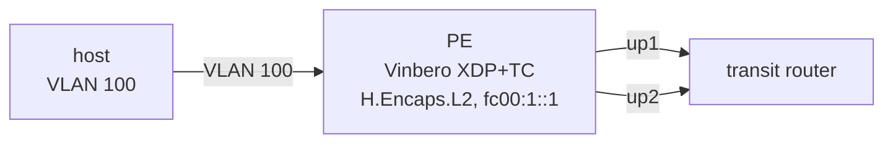

# ECMP の underlay での BUM

*(English: [README.md](./README.md))*

Bridge Domain の peer へ複数の経路（multipath）でつながっているときの、xdp モードの BUM 複製を確かめます。PE は transit のルーターへ 2 本の uplink を持ち、peer は `fc00:100::/32` の locator で、両方の uplink への経路があります。

試験は `peer create` で peer を 8 個作り、Bridge Domain の flood スロット 32 個のうち 8 個を使います。1 つの Bridge Domain が flood するリモート PE は 32 台（計 33 node）までで、スロットは BGP が入れる EVPN の RT3 の peer と共有します（[bum_mode.md](../../docs/design/ja/bum_mode.md)）。



**試験の内容**（`BUM_MODE=tc`、`xdp`、`xdp-native` で実行）:

1. broadcast のフレームが各 peer にちょうど 1 コピー届き、すべての uplink が使われること。tc と xdp のモードで peer ごとの経路が同じで、`BUM_UPLINK_MISMATCH` が 0 であること。xdp モードが各 next hop を managed の neighbor にすること。
2. 経路を nexthop object の group に移し、重みを変え、member を消して戻し、uplink を admin down して戻す。変更のたびに、全 peer に 1 コピーずつ届くこと。
3. gateway の neighbor が FAILED になり、hash-threshold の group がその next hop を外す（netlink の通知はない）。xdp モードではコピーの破棄が組み立て直しの契機になり、その後は全 peer に 1 コピーずつ届く。戻したときも同様。

4. xdp モードで、BD の 2 つの AC が peer の uplink について違う答えを持つ（iif の ip rule）。1 つの devmap では扱えないので、BD は tc モードで動き、全 peer に 1 コピーずつ、AC ごとの table に沿って届く。AC の答えが揃うと xdp モードに戻る。
5. xdp モードで AC の forwarding sysctl を落とすと、全スロットが外れる。sysctl を戻しても netlink の通知は出ないが、定期的な再試行で 30 秒以内にスロットが戻る。

## 実行

```bash
sudo ./setup.sh    # 環境を作る
sudo BUM_MODE=xdp ./test.sh
sudo ./teardown.sh
```
