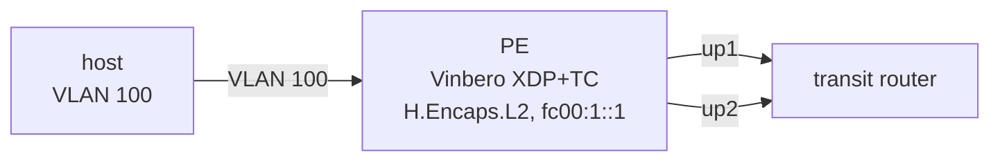

# BUM over an ECMP underlay

*(日本語: [README.ja.md](./README.ja.md))*

Checks xdp-mode BUM replication when the peers of a bridge domain are reached
through a multipath route. The PE has two uplinks to a transit router; the
peers are locators under `fc00:100::/32`, routed over both uplinks.



**Test scenarios** (run with `BUM_MODE=tc`, `xdp` or `xdp-native`):

1. Each peer gets exactly one copy of a broadcast frame, and every uplink is
   used. In tc and in the xdp mode, the same peer uses the same uplink, and
   `BUM_UPLINK_MISMATCH` stays 0. The xdp mode makes each next hop a managed
   neighbour.
2. The route moves to a nexthop-object group; its weights change; a member is
   deleted and added back; an uplink goes admin down and up. After each
   change, every peer again gets exactly one copy.
3. A gateway's neighbour goes FAILED, so its hash-threshold group leaves it
   out, with no netlink event. In the xdp mode a dropped copy triggers the
   rebuild; afterwards every peer gets one copy again. The same when it
   comes back.

## Quick start

```bash
sudo ./setup.sh    # build the environment
sudo BUM_MODE=xdp ./test.sh
sudo ./teardown.sh
```
