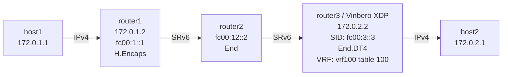

# SRv6 End.DT4 Playground

*(English: [README.md](./README.md))*

Vinbero XDPによるSRv6 End.DT4 (Decapsulation with IPv4 Table lookup via VRF) のデモ環境です。

## トポロジー



**パケットの流れ（host1 → host2の例）:**
1. host1が172.0.2.1にpingを送信（IPv4）
2. router1がLinux native H.Encapsを実行し、IPv4パケットをIPv6+SRHでカプセル化する
3. router2がfc00:2::1でEnd操作を実行する（SL減少、次のセグメントへ）
4. router3（Vinbero XDP）がfc00:3::3でEnd.DT4を実行する
   - 外側IPv6+SRHヘッダを除去する
   - VRF vrf100のルーティングテーブルでFIBルックアップし、host2へ転送する
5. host2がpingを受信する

End.DX4との違いは、End.DT4はVRF内のルーティングテーブルを参照するため、複数の顧客ネットワークをVRFで分離できる点です。

## SIDとテナントのAC

local SIDを引くのは、global VRF（vrf_id 0）の入口から来たパケットだけです。`test.sh` の3番目のフェーズでこれを確かめます。host2は、host1宛ての通信をEnd.DT4のSID `fc00:3::3` へ直接カプセル化して送り、テストはrouter3のEnd.DT4のslotカウンター（`vbctl stats slot show --type endpoint`）を読みます。このため `vinbero_router3.yaml` は `enable_stats` を有効にしています。

- router3のhost2側の口にACが無い間は、その口はglobal VRFに属するので、End.DT4がhost2のパケットをデカプセル化します
- `vbctl vrf ac-add --vrf vrf100 --interface dt4-rt3h2` の後は、その口はテナントのACになります。SIDは引かれず、End.DT4は動きません。パケットは通常のテナントのパケットと同じくheadendのルックアップへ進み、kernelへ渡されます（XDP_PASSのカウンターが増えます）
- 同じパケットにACも設定済みのcircuitも無いVLAN 5のtagを付けると、その口のuntagged側がテナントのACなので、L3やSIDの処理の前にdropされます
- host1からhost2への通信は変わらず届きます。router3のuplinkにはACが無いので、そのパケットはglobal VRFのままSIDに届きます

## kernelのVRF table

XDPがテナントの口からkernelへ渡したパケットは、kernelのVRF tableで引かれます。`setup.sh` はvrf100を `ip link add` で作るので、そのtableには最後に当たる経路が無く、一致しなければmain tableへ進みます。`test.sh` の4番目のフェーズで、VinberoがVRFを管理したときの違いを確かめます。

- host2は、host1宛ての通信をrouter1のEnd.DX4のSID `fc00:1::1` へカプセル化して送ります。これは別のPEのSIDで、router3ではmain tableにしか経路がありません。Vinberoがvrf100を管理する前は、パケットはmain tableへ進んでhost1に届きます
- `vbctl vrf create --name vrf100 --table-id 100` でdeviceをadoptすると、table 100にIPv4とIPv6の `unreachable default` が入ります。同じパケットはVRF tableで止まります
- host2からhost1への通信を運んでいたtable 100のkernelのseg6 routeも、外側のヘッダをmain tableで引く必要があるので、Vinberoが代わりにカプセル化します。`vbctl hv4 create` で、vrf100のACから来たパケットをカプセル化し、外側のヘッダはmain tableで引きます
- host1からhost2への通信（vrf100へのEnd.DT4）は変わらず届きます

## クイックスタート

```bash
sudo ./setup.sh    # 環境構築
sudo ./test.sh     # テスト実行
sudo ./teardown.sh # クリーンアップ
```

## 手動実行

### 1. 環境構築とVinbero起動

```bash
sudo ./setup.sh

# router3のLinux native End.DT4ルートを削除
sudo ip netns exec dt4-router3 ip -6 route del local fc00:3::3/128 2>/dev/null

# Vinbero起動
sudo ip netns exec dt4-router3 ../../out/bin/vinberod -c vinbero_router3.yaml
```

### 2. SidFunction (End.DT4) エントリ登録

```bash
sudo ip netns exec dt4-router3 ../../out/bin/vinbero -s http://127.0.0.1:8082 \
  sid create --trigger-prefix fc00:3::3/128 --action END_DT4 --vrf-name vrf100
```

### 3. テスト

```bash
sudo ip netns exec dt4-host1 ping -c 3 172.0.2.1
```

#### パケットキャプチャ

```bash
# router2-router3間でSRv6パケットを確認
sudo ip netns exec dt4-router3 tcpdump -i dt4-rt3rt2 -n ip6

# router3-host2間でデカプセル化後のIPv4パケットを確認
sudo ip netns exec dt4-router3 tcpdump -i dt4-rt3h2 -n ip
```

### 4. クリーンアップ
```bash
sudo ./teardown.sh
```
