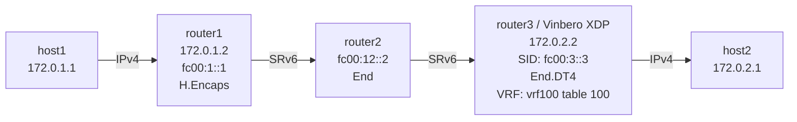

# SRv6 End.DT4 Playground

*(日本語: [README.ja.md](./README.ja.md))*

Demo environment for SRv6 End.DT4 (decapsulation with IPv4 table lookup via
VRF) on Vinbero XDP.

## Topology



**Packet walk (host1 to host2):**
1. host1 pings 172.0.2.1 over IPv4
2. router1 runs Linux native H.Encaps and wraps the IPv4 packet in IPv6 + SRH
3. router2 runs End on fc00:2::1: decrement SL, move to the next segment
4. router3 (Vinbero XDP) runs End.DT4 on fc00:3::3:
   - strips the outer IPv6 + SRH headers
   - resolves the inner packet in VRF vrf100's routing table and forwards it
     to host2
5. host2 receives the ping

The difference from End.DX4 is the VRF routing table lookup, which lets
several customer networks stay separated per VRF.

## SIDs and tenant ACs

Only packets that enter on the global VRF (vrf_id 0) look up local SIDs.
`test.sh` checks this in its third phase. host2 encapsulates its traffic
to host1 straight to the End.DT4 SID `fc00:3::3`, and the test reads
router3's End.DT4 slot counter (`vbctl stats slot show --type endpoint`,
which is why `vinbero_router3.yaml` sets `enable_stats`):

- while router3's host-facing port has no AC, the port is in the global
  VRF and End.DT4 decapsulates host2's packets
- after `vbctl vrf ac-add --vrf vrf100 --interface dt4-rt3h2` the port is
  a tenant AC: the SID is not looked up, End.DT4 does not run, and the
  packets go on to the headend lookup like any tenant packet and are
  passed to the kernel (the XDP_PASS counter rises)
- the same packets with a VLAN 5 tag, which has no AC and no configured
  circuit, are dropped before any L3 or SID processing, because the
  untagged side of the port is a tenant AC
- host1 to host2 keeps working: router3's uplink has no AC, so its
  packets are still in the global VRF and reach the SID

## The kernel VRF table

What XDP passes on from a tenant port is looked up in the kernel's VRF
table. `setup.sh` makes vrf100 with `ip link add`, so its table has no
route of last resort and a miss goes on to the main table. The fourth
phase of `test.sh` shows the difference once Vinbero manages the VRF:

- host2 encapsulates its traffic to host1 to router1's End.DX4 SID
  `fc00:1::1`, a remote PE's SID that router3 has only in its main table.
  Before Vinbero manages vrf100, the packets fall through to the main
  table and reach host1
- `vbctl vrf create --name vrf100 --table-id 100` adopts the device and
  adds an IPv4 and an IPv6 `unreachable default` to table 100. The same
  packets now stop in the VRF table
- the kernel seg6 route in table 100 that carried host2 to host1 needs the
  main table for its outer header too, so Vinbero takes over:
  `vbctl hv4 create --vrf vrf100` encapsulates the packets from the
  vrf100 AC (a packet is looked up in the headend entries of its ingress
  VRF, so the entry is made in vrf100), and their outer header is looked
  up in the main table
- host1 to host2 (End.DT4 into vrf100) keeps working
- router3 keeps the encapsulation's underlay next hop (router2, reached
  through a static route) as a managed neighbour. The test deletes that
  neighbour entry and sends only host2's pings: they get through again
  without any other traffic. It then moves the route to another address
  of router2, whose entry does not exist yet, and the pings get through
  again

The fifth phase restarts vinberod with `internal.bpf.fib_lookup_tbid: "off"`,
which makes it behave as on a kernel whose `bpf_fib_lookup` lacks
`BPF_FIB_LOOKUP_TBID`: every encapsulation takes the ingress lookup, so the
VRF tables stay open. The restart gives back the unreachable defaults of
table 100, host2 to host1 is encapsulated again (its outer header reaches
the main table through the open table), and host2's packets to the remote
SID get through the kernel again.

## Quick start

```bash
sudo ./setup.sh    # build the environment
sudo ./test.sh     # run the tests
sudo ./teardown.sh # clean up
```

## Running it by hand

### 1. Build the environment and start Vinbero

```bash
sudo ./setup.sh

# Remove the Linux native End.DT4 route on router3
sudo ip netns exec dt4-router3 ip -6 route del local fc00:3::3/128 2>/dev/null

# Start Vinbero
sudo ip netns exec dt4-router3 ../../out/bin/vinberod -c vinbero_router3.yaml
```

### 2. Register the SidFunction (End.DT4) entry

```bash
sudo ip netns exec dt4-router3 ../../out/bin/vinbero -s http://127.0.0.1:8082 \
  sid create --trigger-prefix fc00:3::3/128 --action END_DT4 --vrf-name vrf100
```

### 3. Test

```bash
sudo ip netns exec dt4-host1 ping -c 3 172.0.2.1
```

#### Packet capture

```bash
# SRv6 packets between router2 and router3
sudo ip netns exec dt4-router3 tcpdump -i dt4-rt3rt2 -n ip6

# Decapsulated IPv4 packets between router3 and host2
sudo ip netns exec dt4-router3 tcpdump -i dt4-rt3h2 -n ip
```

### 4. Clean up

```bash
sudo ./teardown.sh
```
