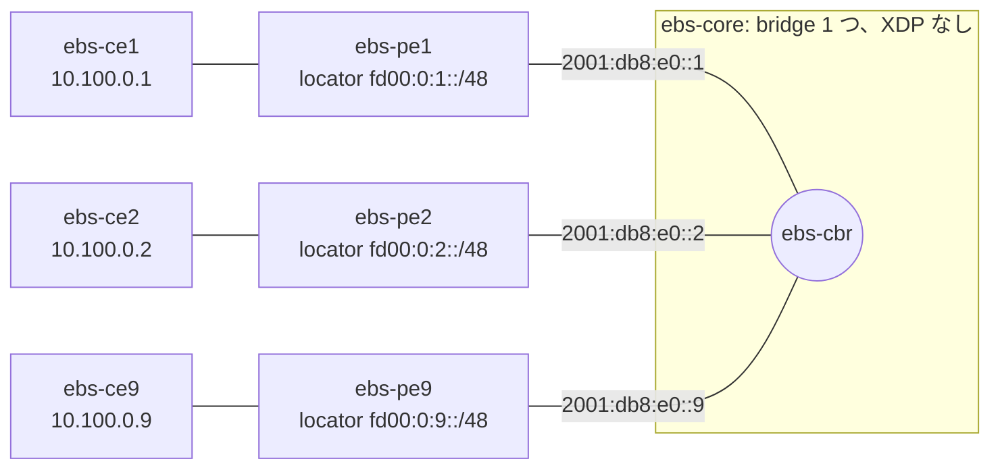

# 1 つの bridge domain に PE 9 台の EVPN BUM

*(English: [README.md](./README.md))*

Vinbero の PE 9 台が iBGP の full mesh で 1 つの EVPN の bridge domain（bd 100）を作ります。各 PE は自分のホストの MAC を RT2（End.DT2U の SID）で、flood の SID を RT3（End.DT2M の SID）で広告します。そのため各 PE は、リモート PE ごとに RT3 の flood peer と RT2 の unicast peer を 1 つずつ入れます。RT2 の peer は flood スロットを使いません。RT3 の peer 8 個が、bridge domain の flood スロット 32 個のうち 8 個を使います。1 つの bridge domain が flood できるのはリモート PE 32 台（計 33 node）までで、その大きさで同じ試験を行うのが [evpn-bum-scale-33](../evpn-bum-scale-33/) です。peer の index の範囲は [bum_mode.md](../../docs/design/ja/bum_mode.md) を参照してください。



PE 3〜8 も同じ構成です。PE は core のアドレス（`2001:db8:e0::N`、AS 65100、family `evpn`）で peer を張り、他の PE の locator への経路を core の segment 上のその PE に向けます。core の bridge には Vinbero の program がないので、そのポートの capture で各 PE が送受信したものが分かります。

## 試験の内容

`BUM_MODE=tc`（既定）、`xdp`、`xdp-native` で実行します。

1. 各 PE が bd 100 に peer 16 個（RT3 8 個、RT2 8 個）とリモートの MAC 8 個を入れ、peer の index 不足をログに出さないこと。
2. 既知 unicast: すべてのホストの組で ping が通ること。あるホスト宛ての unicast のフレームが、そのホストの PE とホストにだけ届くこと。
3. 最初と最後のホストからの未知 unicast と broadcast、ホスト 1 の ARP 要求: 各リモート PE が core からちょうど 1 コピー受け取り、各リモートのホストもちょうど 1 コピー受け取ること。どの PE も core へコピーを送り返さず、送信元のホストにもコピーが戻らないこと。
4. Ethernet Segment の split horizon: PE 8 と PE 9 が同じ ESI を持ち、PE 8 はその ESI の付いた MAC を RT2 で広告します。ホスト 8 の broadcast は各 PE に 1 回ずつ届き、PE 9 はそれを破棄（`SPLIT_HORIZON_RX`）して、ホスト 9 にはコピーが届かないこと。他のホストには 1 コピーずつ届くこと。

## 実行

```bash
make build            # リポジトリの root で
cd examples/evpn-bum-scale
sudo ./setup.sh
sudo BUM_MODE=tc ./test.sh
sudo ./teardown.sh
```

`NUM_PES=<n>`（`setup.sh` と `test.sh` で同じ値、33 まで）で PE の台数を変えられます。確認の内容は台数に合わせて変わります。34 台以上では、各 PE がすべてのリモート PE の RT3 の peer を入れられず、最初の確認が失敗します。これが bridge domain あたり 32 個の flood スロットの上限です。daemon のログは `/tmp/vinbero_ebs_pe<N>.log` です。
