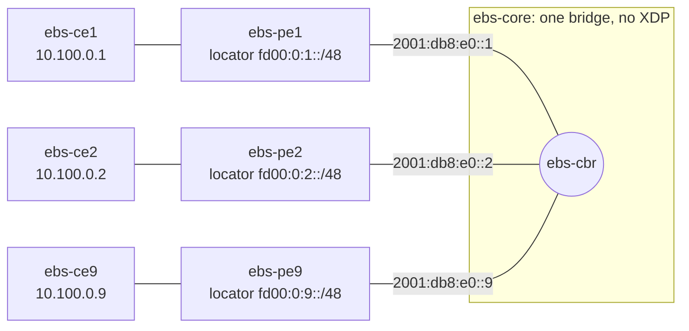

# EVPN BUM with nine PEs in one bridge domain

*(日本語: [README.ja.md](./README.ja.md))*

Nine Vinbero PEs form one EVPN bridge domain (bd 100) over an iBGP full mesh.
Each PE advertises its host's MAC as an RT2 (End.DT2U SID) and its flood SID
as an RT3 (End.DT2M SID), so every PE installs, per remote PE, one RT3 flood
peer and one RT2 unicast peer. The RT2 peers take no flood slot: the 8 flood
slots of a bridge domain hold the 8 RT3 peers, which is the most a bridge
domain floods to (8 remote PEs, 9 nodes). See
[bum_mode.md](../../docs/design/ja/bum_mode.md) for the peer index ranges.



PE 3 to 8 are the same. The PEs peer over their core addresses
(`2001:db8:e0::N`, AS 65100, family `evpn`); each routes the other PEs'
locators to them on the core segment. The core bridge carries no Vinbero
program, so captures on its ports show what each PE sends and receives.

## What the test verifies

Run with `BUM_MODE=tc` (default), `xdp` or `xdp-native`:

1. Every PE installs 16 peers in bd 100 (8 RT3, 8 RT2) and 8 remote MACs, and
   logs no peer index shortage.
2. Known unicast: every host pings every other host, and a unicast frame to
   one host reaches that host's PE and host only.
3. Unknown unicast and broadcast from the first and the last host, and an ARP
   request from host 1: each remote PE receives exactly one copy from the
   core, each remote host exactly one, no PE sends a copy back into the core,
   and the sender's host gets none back.
4. Split horizon on an Ethernet Segment: PE 8 and PE 9 attach the same ESI
   and PE 8 advertises a MAC on it (RT2 with the ESI). A broadcast from host 8 reaches
   every PE once, PE 9 drops it (`SPLIT_HORIZON_RX`) and host 9 gets no copy;
   the other hosts get one each.

## Running

```bash
make build            # from the repository root
cd examples/evpn-bum-scale
sudo ./setup.sh
sudo BUM_MODE=tc ./test.sh
sudo ./teardown.sh
```

`NUM_PES=<n>` (the same for `setup.sh` and `test.sh`) runs the topology with
another number of PEs. With more than 9, the PEs cannot install every
remote PE's RT3 peer and the first check fails: that is the limit of 8
flood slots per bridge domain. The daemons log to
`/tmp/vinbero_ebs_pe<N>.log`.
